The goal of this lesson is to demonstrate how to make a simple map, suitable for inclusion in a publication, using ArcGIS Online. As an exercise, you will be creating a map of the UCSB campus bicycle infrastructure and proposing a campus access improvement. We will follow a typical workflow of:

1.  Start with a basemap
2.  Add feature layers from the UCSB campus
3.  Draw annotations on top of the map
4.  Prepare the map for presentation and export it

As we will describe under [Other approaches](#sec-other-approaches) at the end of this lesson, there are many tools and techniques that can be used to create such a map. An advantage of using a GIS tool such as ArcGIS Online, and the central motivation for using GIS in this lesson, is that a GIS tool allows map elements to be interpreted and manipulated as data, and in this way spatial analysis becomes possible.

ArcGIS Online is but one of many GIS tools in existence. We use it in this lesson because it is in wide use in both commercial and academic settings. However, it is important to recognize that it is a proprietary and closed system that requires a paid subscription to use. We note limitations and ramifications of using ArcGIS Online on the reproducibility and citability of one's work under [Caveats of using ArcGIS Online](#sec-caveats) at the end of this lesson.

# Our goal for today

Our goal is to develop a map of the UCSB campus that illustrates the current bicycle infrastructure, specifically highlighting bike paths and racks. Additionally, the map will incorporate annotations for proposed infrastructure improvements, such as a connecting bike path and a pedestrian safety dismount zone.

[At the end of our session we should end up with something like this](https://arcg.is/0iD4jS0){target="_blank"}

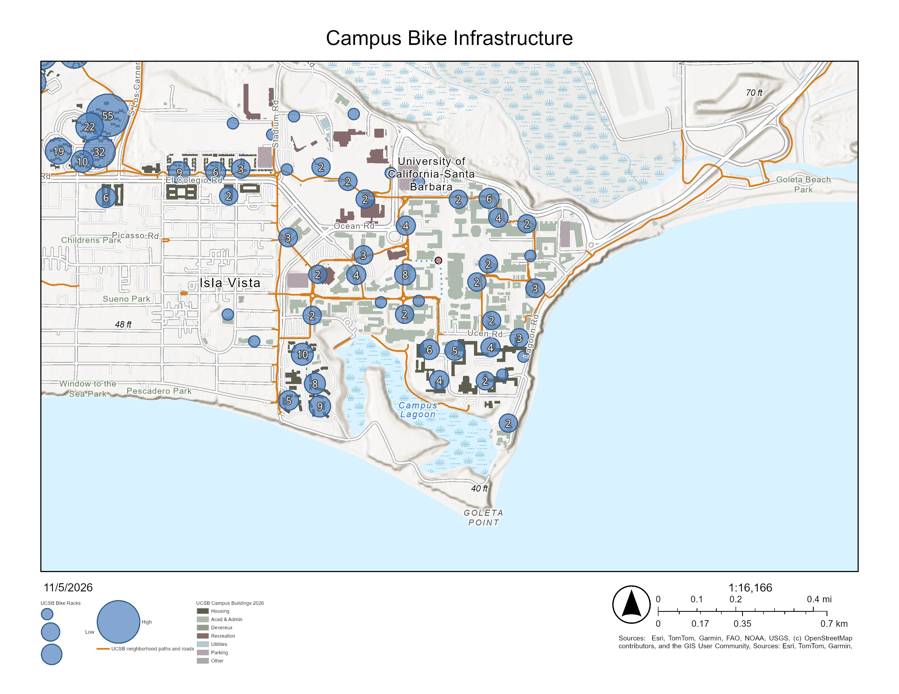{#fig-prelim}

<br>

Our final interactive map is also embedded below:

<arcgis-embedded-map style="height:600px;width:700px;" item-id="99931eb33b1144598bdecd5c21b7c8d8" theme="light" heading-enabled legend-enabled information-enabled share-enabled time-zone-label-enabled center="-119.84576230906848,34.41226485167855" scale="18055.954822" portal-url="https://ucsb.maps.arcgis.com"></arcgis-embedded-map>

As we will discuss at the end of this lesson, there are many ways of making such a map without using a GIS tool. In fact, in many cases GIS is overkill, both because most of the features GIS tools provide will not be used and because the GIS interface can be cumbersome. But an advantage of GIS is that it opens up the possibility of treating map elements as data, and that in turn opens up and provides an introduction to the world of spatial analysis.

<hr>

# Introduction to ArcGIS Online

A brief tour of the interface.

## Log on to ArcGIS Online

[**https://ucsb.maps.arcgis.com**](https://ucsb.maps.arcgis.com){target="_blank"}

**Sign on with your UCSB NetID**. You may need to enter "ucsb" into the url box. **Do not use the ArcGIS login!** This is for users who do NOT have a UCSB NetID.

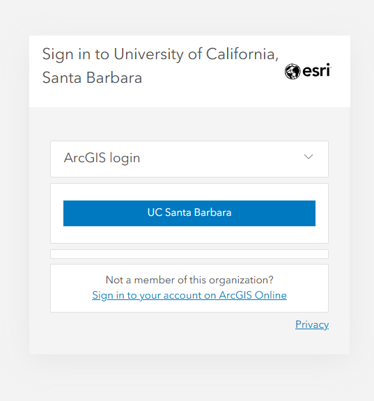{#fig-arcgis width="40%" fig-align="center"}

You should have a similar landing page indicating that you are using the ArcGIS online under the UCSB license. *You may need to authenticate with DUO on your phone*.

## Tour of the user interface

The main organization page lists the campus administrative contacts and open data groups available on campus. You can also see the latest content published by users on your campus.

Along the top of the page is the main toolbar.

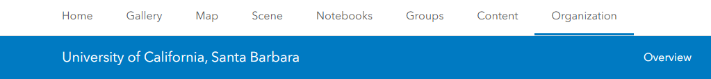{#fig-menubar width="90%" fig-align="center"}

-   `Home` will take you to the main landing page when you first sign in.
-   The `Gallery` contains items from our 'featured content' group
-   `Groups` are a list of groups which you can create or join. Some are invitation only. These are popular when you are working in group projects. For this workshop, we have created a group called [From Maps to Analysis](https://ucsb.maps.arcgis.com/home/group.html?id=92f4de804b2c46eaa70cebc517ecb067#overview){target="_blank"} which contains most of the data layers we will be using.
-   `Content` is where your created or uploaded content is listed. You can make folders in here to organize your layers and features.
-   `Notebooks` is ESRI's version of a JupyterHub-like environment. You can use ArcPy here. This may not be available to you based on your user role.
-   `Organization` will take you back to our main page. This is not the same as Home.
-   `Scene`, or `Scene Viewer` is where you can create 3D GIS scenes, such as neighborhood models and digital twins.
-   `Map`, or `Map Viewer` is where you can create 2D maps. ***We will be focusing on using the Map Viewer for this workshop.***

# The Map Viewer

Open a new, empty map by clicking `Map` on your top menu bar.

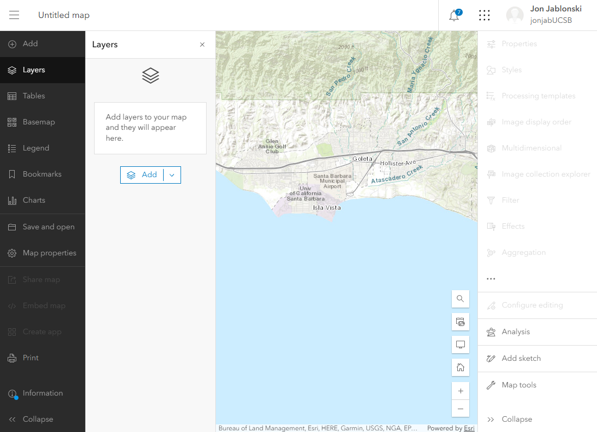{#fig-emptymap width="50%" fig-align="center"}

## Main Map components

In the Map Viewer there is a menu bar in the left column. This is where you can add components to your map. The way to think about a map is that it is made of different layers that are added on top of each other. Each layer adds specific information to your map. In our example, we will have a layer for the bike paths, one for the bike racks, one for the buildings, and so on... The base layer is special and often made of an image (but does not have to be). It is called a **basemap**. Here are the main components of your map:

-   `Basemap`: there are many provided by ArcGIS Online
-   `Layers`: your own and/or those shared by others
-   `Legend`: The symbology used on your map
-   `Save and open...`: Where you save your content

## Basemap

The goal of a basemap is to provide context in terms of location and/or theme. In ArcGIS Online, a new map will always open with a basemap. Esri has about 20 different basemaps available. We will start with the default: the **Topographic** basemap.

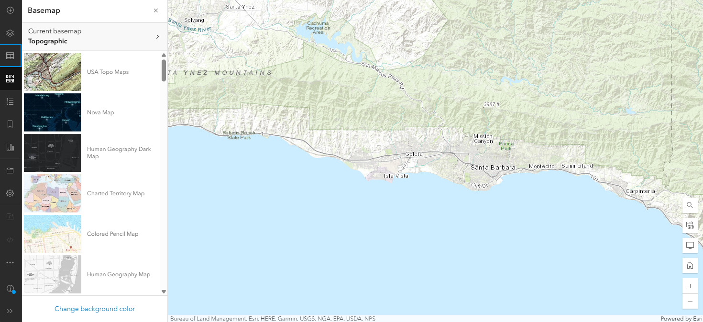{#fig-defaultmap width="90%" fig-align="center"}

In general, make sure you choose a basemap that is easy to follow and accurate in relation to the goal of your map. Avoid using busy basemaps that provide information not relevant to the purpose of your map. Additionally, choose a basemap that does not visually conflict with or override the layers on top. The *message* of your map is whatever you layer and annotate on top of the basemap; the basemap is there only to provide context.

## Feature layers

Feature layers are the layers you add on top of your basemap. They are the main information your map is aiming at communicating. In ArcGIS, when you add an existing layer to your map, it will show up under your `Layers`. When you want to see the layer properties, you can either use the menu on the right hand column to view its properties or use the `...` (we call this a "meatball" menu) next to the layer to open the same panel.

## Save your work - Save early, save often

{#fig-saveas width="30%" fig-align="center"}

-   There will be a blue dot next to the `save` icon until you save
-   You can organize all of your content into folders -- Let's make a folder for all of our work today. **bike_map_workshop**
-   Once you save, more options will be available
-   ArcGIS Online **will not auto-save** your map

<hr>

# UCSB bike infrastructure map

With that introduction, you now have the opportunity to start creating your own map. The goal here is to create a map of the bike infrastructure on campus (bike lanes as lines, bike racks as points, buildings as polygons) and to then annotate on top of that a campus access proposal for bicyclists and pedestrians.

## Step 1: Add layers to your map

### Import lines Feature layer (bike paths)

From the **Layers** panel, click on the add layer button. Search `My organization` for **UCSB neighborhood paths and roads**. There should be only one result.

::: {#fig-addinglayer}
```{=html}
<video controls autoplay loop muted playsinline width="100%">
  <source src="images/workshop1/Step1/add-layers.mp4" type="video/mp4">
</video>
```
Adding a layer
:::

::: {.callout-tip collapse="true"}
## Challenge: Repeat the above steps to add the feature layer `UCSB Bike Racks` to your map.

### Import points layer (bike racks)

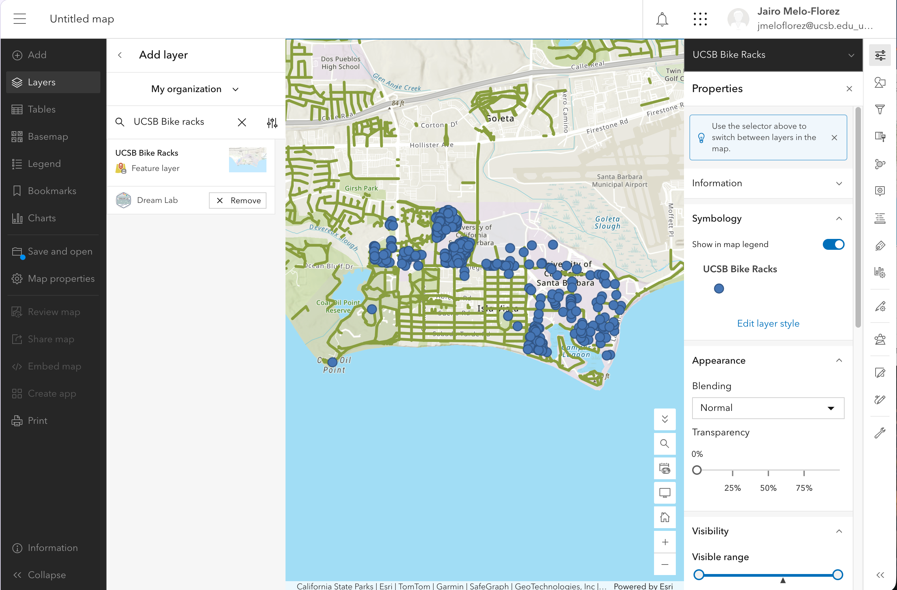{#fig-bikeracks width="80%"}
:::

::: {.callout-tip collapse="true"}
## Challenge: Find the 'From Maps to Analysis' group and add the `UCSB Campus Buildings 2026` layer from there.

### Add a layer via Groups

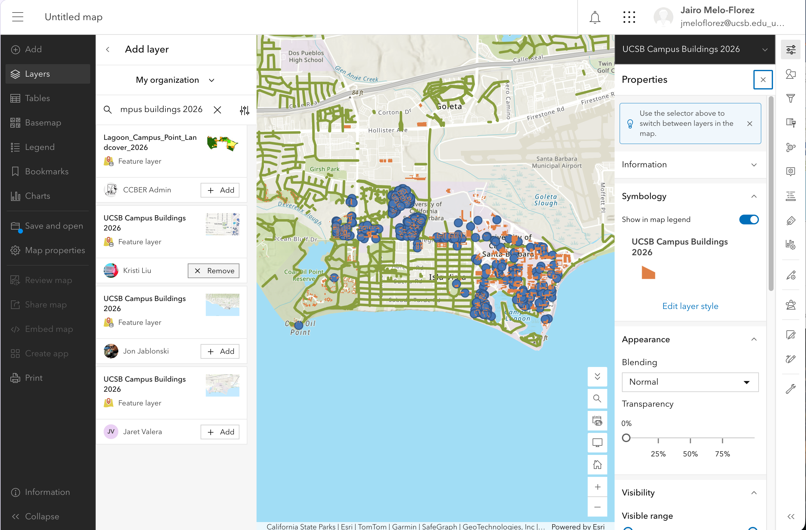{#fig-buildinglayers width="90%"}
:::

### Reorder layers

After importing the three layers, you'll notice they might not display optimally. There's a GIS convention for layer ordering that helps ensure all features remain visible:

**Layer Order Convention (top to bottom):**

-   Points (e.g., bike racks) - should be on top
-   Lines (e.g., bike paths) - in the middle
-   Polygons (e.g., buildings) - at the bottom

This ordering ensures that smaller features aren't hidden beneath larger polygon areas.

For our map, the recommended order from top to bottom should be:

1.  `UCSB Bike Racks` (top)
2.  `UCSB neighborhood paths and roads` (middle)
3.  `UCSB Campus Buildings 2026` (bottom)

To reorder the layers, click and hold on a layer name in the Layers panel, drag it to the desired position, and release.

::: {#fig-reorderlayers}
```{=html}
<video controls autoplay loop muted playsinline width="100%">
  <source src="images/workshop1/Step1/reorder-layers.mp4" type="video/mp4">
</video>
```
Reorder feature layers
:::

### Accessing the underlying data

*Feature layers* are driven by data. Each point, line, or polygon has associated with it a row in an attribute table providing information on that specific record.

For example, if you click on the three dots on the right of a feature layer you can access its *attribute table* by selecting `Show table`.

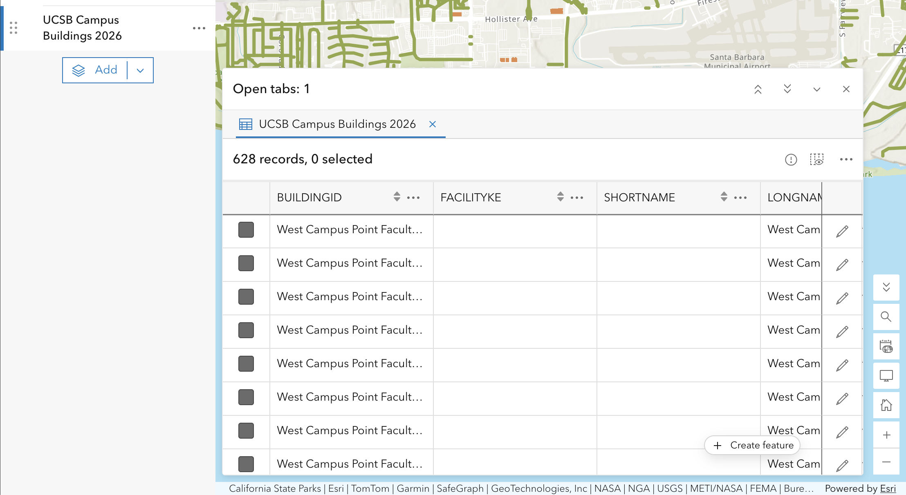{#fig-attribute width="90%"}

In ArcGIS Online feature layers, we can understand the relationship between rows, columns, and features as follows:

- Each **row** represents a **feature**: A row (record) corresponds to an individual spatial object on the map, such as a specific bike rack, a segment of a bike path, or a building.
- Each **column** represents an **attribute**: Each column (field) corresponds to one specific attribute category or field name, such as the name of a building, the type of bike rack, or the length of a bike path. The value in each cell represents the specific attribute for that feature.

Your data can be visualized, selected, or analysed based on the columns of the attribute table. We will see later how you can leverage these attributes to set the symbology of a layer according to categories or quantities that are in the attribute table. You can also compute new attributes either based on other attributes or by performing analysis with other layers' information. We will cover analysis tools [in our second workshop](02_intro_gis.html).

::: {.callout-note collapse="true" title="Save often."}
Now that you have added the layers to your map, it's a good idea to save it again.

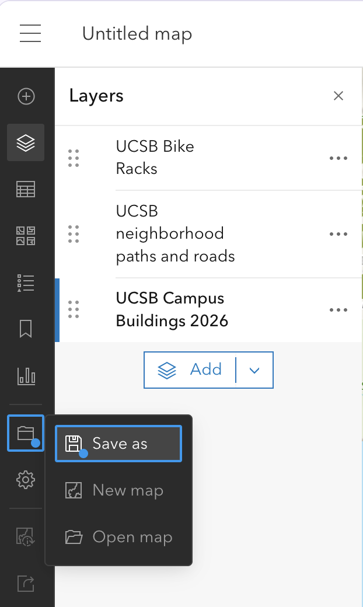{#fig-saveas-step1 width="30%" fig-align="center"}

In there, you can add a title, tags, and a short description of your map.
:::

## Step 2: Customize symbology & transparency

After adding our three layers, we have some work to do to make the map more readable. Let's begin by adjusting the visibility of the `UCSB Bike Racks` layer. Currently, each bike rack is represented by a blue circle, which makes it difficult to identify the number of bike racks in a given area. We can use the **aggregation** feature to group the bike racks into dynamic clusters, which will facilitate the visualization of the number of bike racks in a given area. This feature will automatically group the bike racks into clusters based on the map scale, so that when you zoom in, the clusters will break apart into individual bike racks.

To enable aggregation, follow these steps:

- Click on the layer `UCSB Bike Racks` to open its properties panel.
- On the right side panel, click on the Aggregation button (the fifth button from the top).
- In the Aggregation panel, select the `Clustering` option. This will enable the clustering of bike racks based on the map scale.

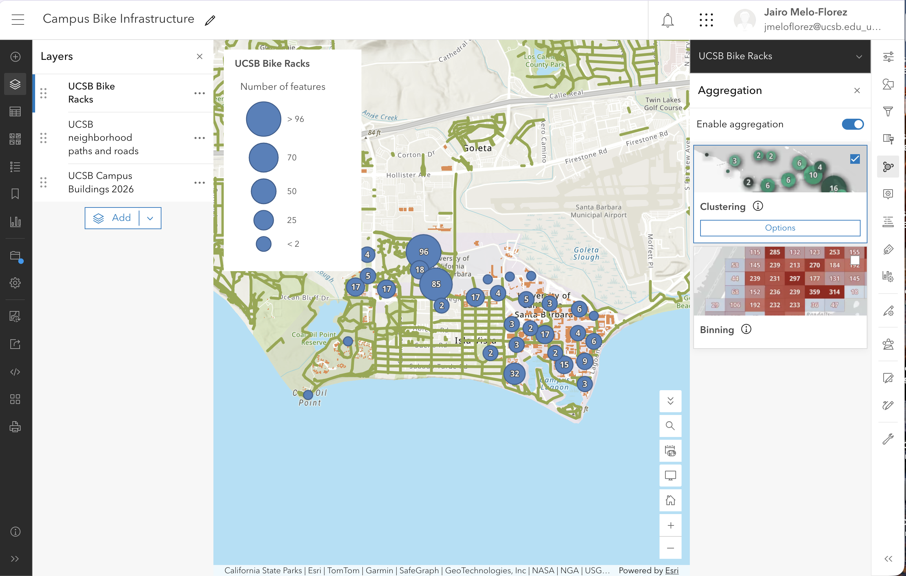{#fig-aggregation width="90%" fig-align="center"}

We can also adjust the transparency of the circles representing the bike racks to smooth the circle overlap. To do this, follow these steps:

- Click on the layer `UCSB Bike Racks` to open its properties panel.
- On the right side panel, click on the `Styles` button (the second button from the top).
- In the Styles panel, go to the **Pick a style** section, and click on the `Style options` button.
- In the Style options panel, click on the edit button (the pencil icon) next to the symbol in the Symbol style list.
- In the Symbol style panel, set the `Fill transparency` to 30%. Changes will be applied immediately to the map.

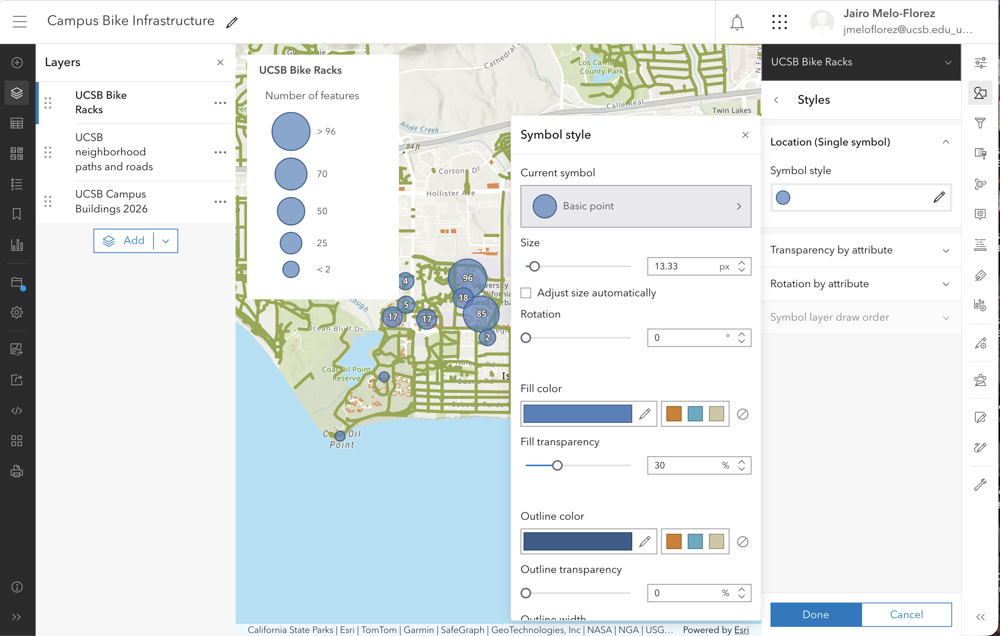{#fig-transparency width="90%" fig-align="center"}

To have a better view of the bike racks area, click on the three dots next to the `UCSB Bike Racks` layer and select `Zoom to layer`. This will zoom in to the extent of the bike racks layer.

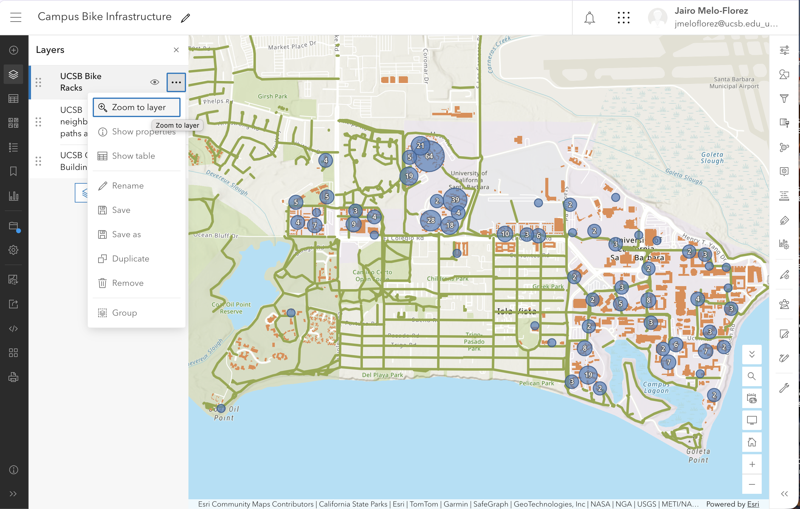{#fig-zoom width="90%" fig-align="center"}

### Adjust style based on attribute

Our map is starting to look good, but you can notice that the buildings are all filled with the same color (orange in our case). Although the buildings are not the main focus of our map, this layer can be useful to provide context, so we can adjust the symbology to make it more informative. 

To achieve this, we can adjust the symbology of the `UCSB Campus Buildings 2026` layer based on an attribute. Our first step is to identify the attribute we want to use. We can open the layer attribute table as we previously showed, or we can see the available attributes directly from the Styles panel. To do this, follow these steps:

- Click on the layer `UCSB Campus Buildings 2026` to open its properties panel.
- On the right side panel, click on the `Styles` button (the second button from the top).
- In the Styles panel, go to the **Choose attributes** section, and click on the `+ Field` button. This will show you the available attributes for this layer.

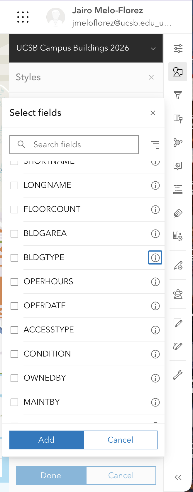{#fig-attributes width="30%" fig-align="center"}

To explore the values of the attributes, you can click on the (i) icon next to the attribute name. This will show you the metadata for that attribute and a list with its top 10 values. 

For this exercise, we will use the `BLDGTYPE` attribute, which represents the building type (e.g., housing, academic and administrative, recreation, parking, etc.). This attribute will allow us to fill each building with a different color based on its use.

- Check the box next to the `BLDGTYPE` attribute and click on the `Add` button. This will add the attribute to the **Choose attributes** section, and set a predefined color ramp to fill the building areas based on their use.

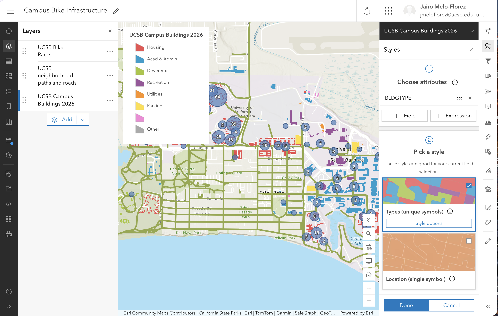{#fig-addattribute width="90%" fig-align="center"}

We can select a color ramp that better fits our map:

- In the Styles panel, click on the `Style options` button in **Types (unique symbols)** section.
- Click on the edit button (the pencil icon) next to the color ramp in the Symbol style list.
- In the Symbol style panel, click on the edit button (the pencil icon) next to the color ramp in the Colors section.
- Select the *Stone and Gravel* color ramp. Changes will be applied immediately to the map.

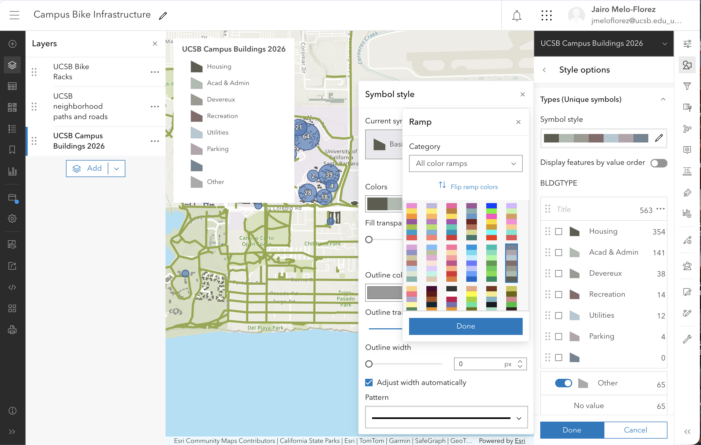{#fig-changecolorramp width="90%" fig-align="center"}

In this specific layer we also have a category with no label and zero records. We can remove this category by clicking the check box next to it and selecting `Remove` from the contextual menu.

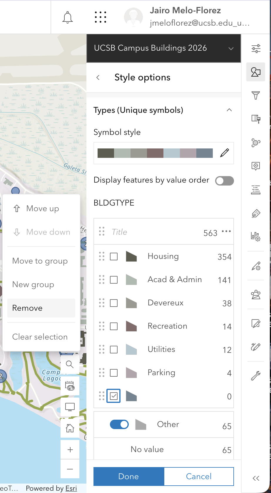{#fig-removeempty width="30%" fig-align="center"}

### Filter layer based on attribute

Finally, we are interested in displaying bike paths from the `UCSB neighborhood paths and roads` layer that also contains roads, pathways and other features. We can filter the categories we are interested in using the filter function on the right sidebar.

-   Click on the layer `UCSB neighborhood paths and roads` to select it.
-   Click on the `Filter` button on the right sidebar (third from top).

    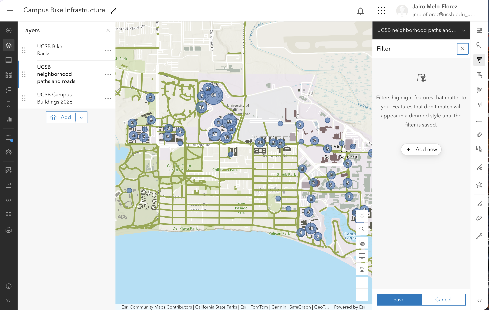{#fig-filter-selection fig-align="center"}

-   Click `Add new`
-   In the condition box, choose the `highway` field and the `includes` condition, and select `cycleway`
-   Don't forget to save with the button at the bottom!

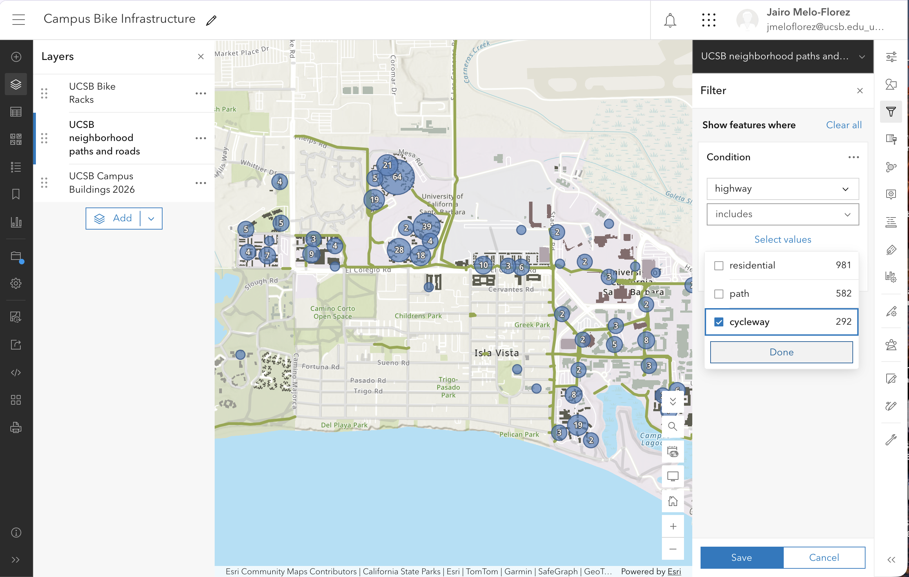{#fig-filter-on fig-align="center"}

Because bike paths are relevant to our map, we can change the color to make them stand out more. To do this we can change the symbol color to a warm, earthy ochre color that contrasts with the blue of the bike racks and colors of the basemap.

- Click on the layer `UCSB neighborhood paths and roads` to select it.
- Click on the `Styles` button on the right sidebar (second from top).
- In the Styles panel, click on the `Style options` button in **Types (unique symbols)** section.
- Click on the edit button (the pencil icon) next to the symbol in the Symbol style list.
- In the Symbol style panel, click on the color box and type in the <span data-bs-toggle="tooltip" title="A 6-digit code used to represent colors on screens" style="border-bottom: 1px dashed #666; cursor: help;">hex code</span> `d67d1e` for the ochre color. 

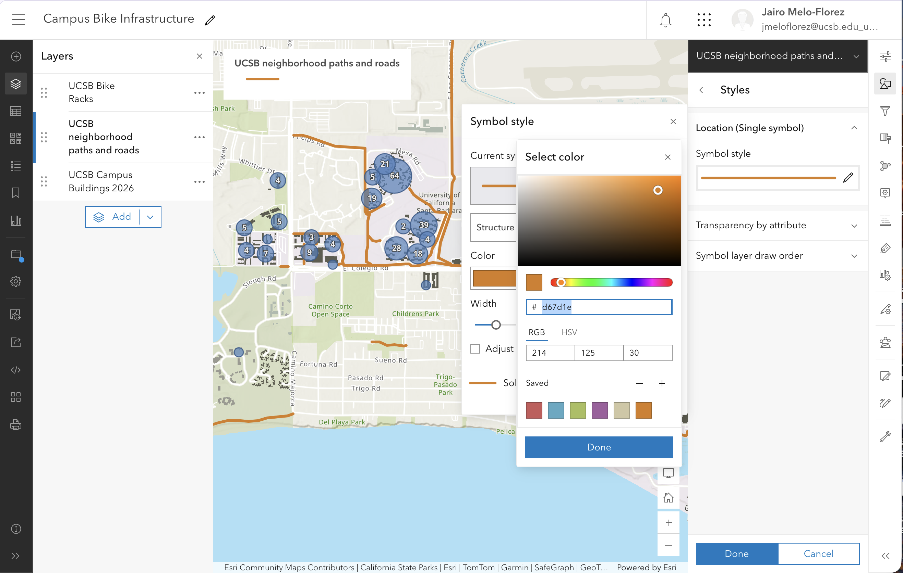{#fig-changecolorroad width="90%" fig-align="center"}

- Change the width of the line to 2 px to match the width of the basemap roads.

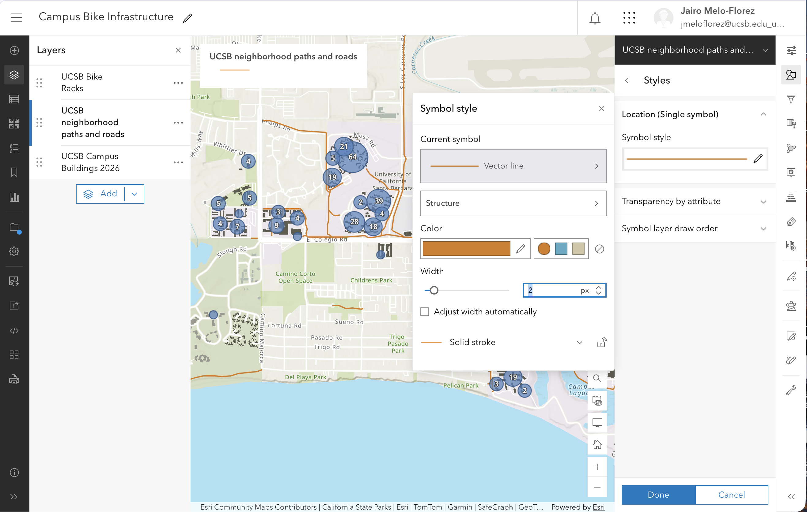{#fig-changewidthroad width="90%" fig-align="center"}

::: {.callout-note collapse="true" title="Save often."}
Now that you have customized the symbology of your layers, it's a good idea to save your map again.

{#fig-saveas-step2 width="30%" fig-align="center"}

In there, you can add a title, tags, and a short description of your map.
:::

### Select a different basemap

After adding the layers and customizing their symbology, we have a good, almost ready map. However, the current basemap (Topographic) is a bit too busy and makes it hard to see the features we added. Let's change it to a different basemap using the `Basemap` option in the left menu bar.

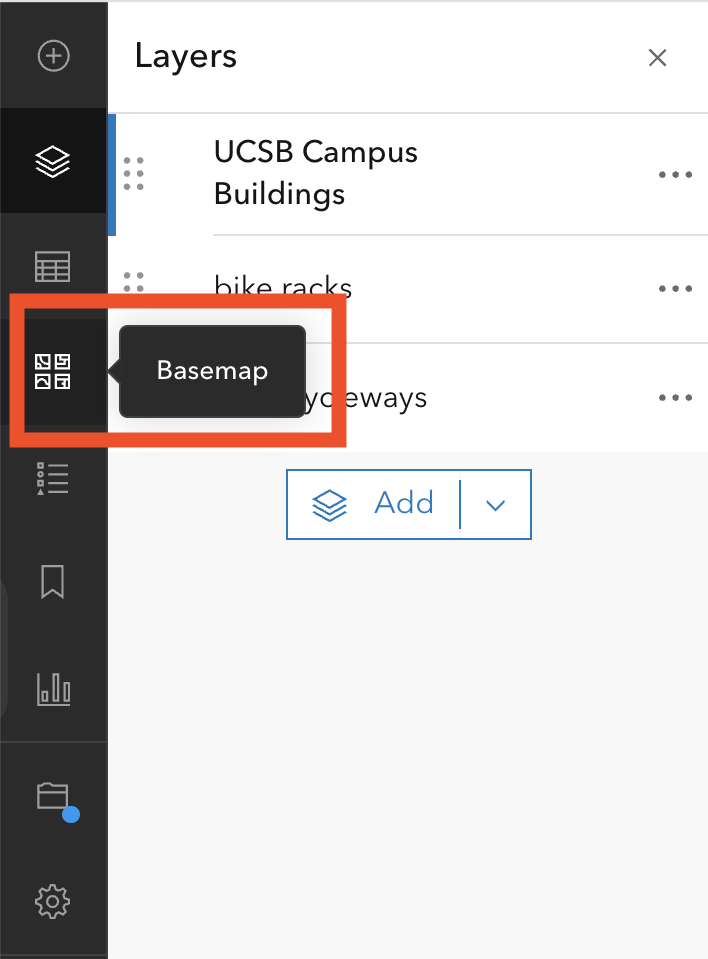{#fig-basemapoption width="40%" fig-align="center"}

From the basemap gallery, we can select another basemap. In our case, we will select the **Terrain with Labels** basemap, which is a lighter version of the Topographic basemap. This will make our features stand out more and make the map easier to read.

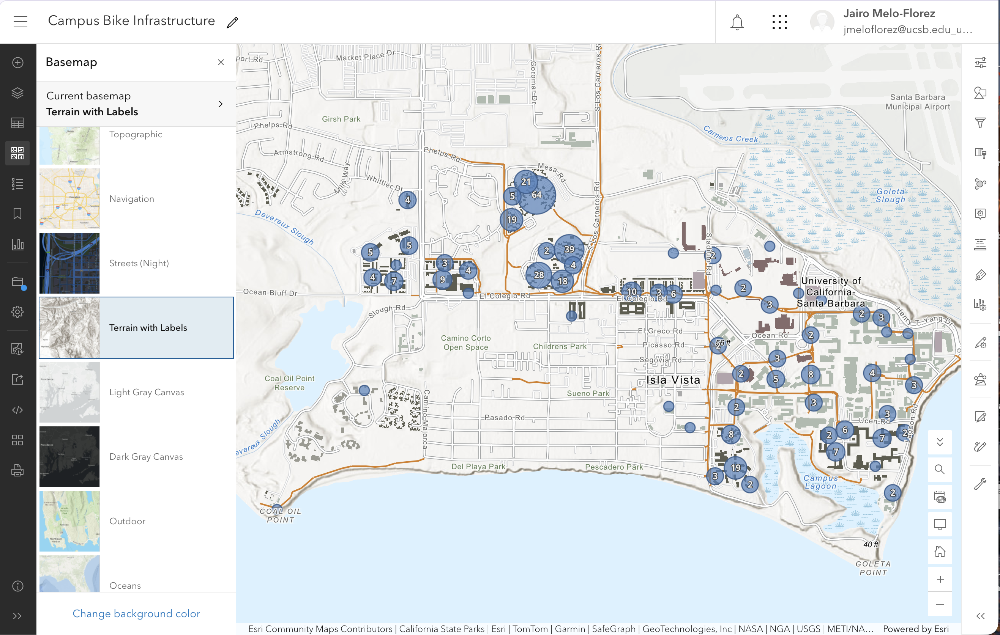{#fig-topolabels width="90%" fig-align="center"}

**Don't forget to save your map after making these changes!**

## Step 3: Annotate the map

In addition to bringing in structured geospatial data layers, maps are often used to sketch ideas, mock up proposals, or add contextual annotations. This is a common practice in urban planning and design.

We can add these annotations by creating a **sketch layer**. Unlike feature layers, sketch layers are designed for drawing shapes (points, lines, polygons, circles, text) directly onto the map as descriptive elements.

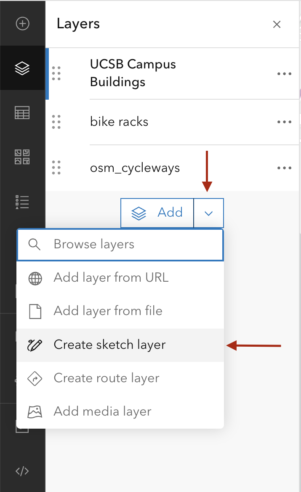{#fig-sketchlayer width="40%" fig-align="center"}

After adding the sketch layer to your workspace, a new menu will appear in the right column with drawing tools and configuration options.

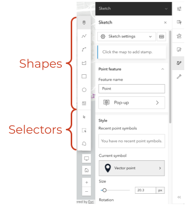{#fig-drawingtools width="40%" fig-align="center"}

### The Campus Access Proposal

Imagine you are a campus active transportation planner. Your goal is to propose an infrastructure upgrade that connects an existing bike path to a campus building with high bike-parking density (visible from your `UCSB Bike Racks` and `Buildings` layers) where no direct bike path currently exists. 

To present your proposal, you will add exactly **two** sketches to your map: a proposed connecting path and a safety dismount zone.

### 1. Proposed Path Connector (Line)

Find a major campus building that is near a bike path but lacks a direct bike-lane connection to its entrance or bike racks. 

- Select the **line drawing tool** from the sketch layer menu.
- Click on an existing bike path to start drawing your proposed route, click to add vertices (turns) along pedestrian pathways or open spaces, and **double-click** to finish the line at the building's entrance plaza.

Customize the line symbol in the sketch layer menu to make it look like a planning proposal:

- **Width:** `2 px`
- **Pattern:** `Dotted` or `Dashed`
- **Color:** Light Blue (`#5aaac4`) or an eye-catching accent color of your choice.

::: {#fig-drawingline}
```{=html}
<video controls autoplay loop muted playsinline width="100%">
  <source src="images/workshop1/Step3/drawing-line.mp4" type="video/mp4">
</video>
```
Drawing a proposed route line on the map
:::

### 2. Pedestrian Safety Dismount Zone (Circle or Polygon)

Because your proposed path ends at a busy building entrance, we need to designate a safety buffer zone where bicyclists must dismount to prevent conflicts with pedestrians entering and exiting the building.

- Select the **circle drawing tool** (or polygon tool) from the sketch layer menu.
- Click and drag near the building entrance to create a buffer zone covering the plaza where the new path terminates.
- Click on the select tool to finish the shape.

Customize the zone to look like a semi-transparent advisory overlay:

- **Fill color:** Red (`#d13434`) or Orange
- **Fill transparency:** `40%` (allowing the underlying basemap and buildings to remain visible)
- **Outline:** Thin solid line or no outline

::: {#fig-drawingcircle}
```{=html}
<video controls autoplay loop muted playsinline width="100%">
  <source src="images/workshop1/Step3/drawing-circle.mp4" type="video/mp4">
</video>
```
Drawing a dismount zone circle on the map
:::

---

Finally, rename your sketch layer to **Proposed Improvements** to reflect its purpose. Click on the three dots next to the sketch layer, select `Rename`, enter the new name, and click `OK`.

**Save your map after making these changes!**

## Step 4: Prepare the map for publication

Almost there! At this point you're ready to start packaging your map for publication.

To do that, you need to look for the `Print` option in the left menu bar.

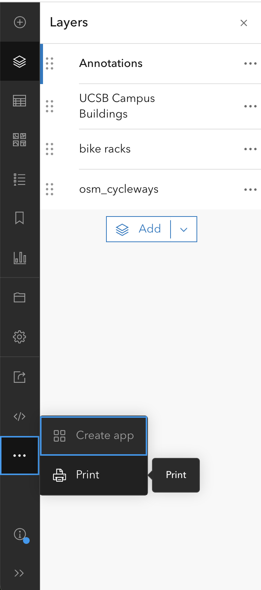{#fig-printoption width="30%" fig-align="center"}

For exporting the map you have two options:

-   `Layout`: This option allows you to create a more complex layout with additional map elements such as title, legend, scale bar, north arrow, etc. You can choose from several pre-defined templates or create your own custom layout.
-   `Map only`: With this option, you can export just the map itself without any additional elements. You can choose the file format (PNG, PDF, etc.) and the resolution of the exported map.

For our purposes, we will select the `Layout` option to create a more complete map for publication.

In the layout menu, you can change the title of the map, select a `Template` (which is basically a standard page size and orientation), and select the `File format` for the export (e.g., PNG, PDF).

You can also customize the layout further by enabling the `Advanced options` panel. You can set the scale, add an author name, include copyright information, increase or decrease the resolution, indicate the [output spatial reference](https://developers.arcgis.com/rest/services-reference/enterprise/using-spatial-references/){target="_blank"}, and select to include legend, north arrow, and scale bar.

Adjust the zoom and position of the map in the preview window to ensure everything is visible and well-framed.

::: callout-tip
# Map resolution

If your map is intended for **print publication**, it is recommended that you set your DPI value to 300 dpi. For **web or screen display**, 96 dpi is generally sufficient and will produce a smaller file size.
:::

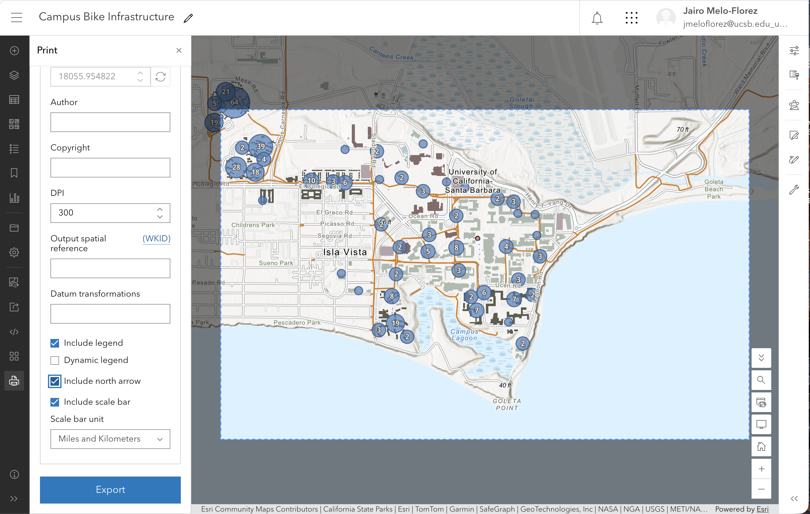{#fig-exportlayout width="90%" fig-align="center"}

## Step 5: Share your map

When you're satisfied with the layout and settings, click on the `Export` button to generate the map. Depending on the selected file format and resolution, it may take a few moments to process the export.

The result will be listed in the `Exports` panel, where you can save the file to your computer by clicking on the three dots next to the export and selecting `Save as`.

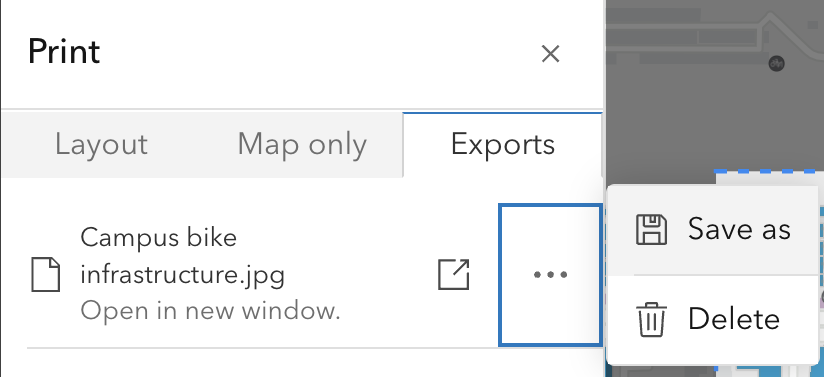{#fig-savingmap width="40%" fig-align="center"}

This will save the exported map to your ArcGIS Online content. You can access it later from the `Content` menu in the top menu bar. The new item will be available as an Image file that you can download to your computer.

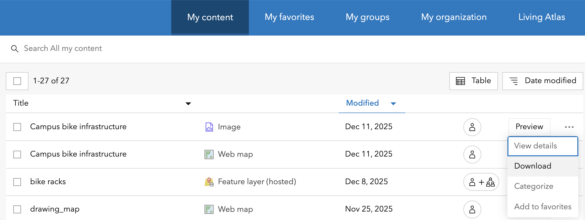{#fig-downloadmap width="90%" fig-align="center"}

::: {.callout-warning collapse="true"}
# Public sharing

You can share your map publicly and embed it on a website, just like we did at the beginning of this lesson. However, for this to work, you need to set the visibility of all your map layers to public.
:::

<hr>

## Preview for Workshop 2: Working with data

In Workshop 2, we dive deeper into managing and manipulating various types of geospatial data in ArcGIS online. Building on our biking project from Workshop 1, we will combine terrain data with local trailhead locations to analyze trail accessibility by bike. 

In this second session, you will learn to:

- Understand the vector and raster geospatial data types
- Import external data into ArcGIS Online
- Create, edit, and update data of feature layers
- Export processed data from ArcGIS Online back to your local machine


<hr>


## Other approaches {#sec-other-approaches}

There are many ways of making a simple map. Here are some alternative approaches.

-   By screen grabbing: Create a base layer by screen grabbing a source map displayed in a web browser window (e.g., Google Maps). Then, using a drawing tool (a dedicated drawing tool such as Adobe Illustrator, or any program that provides drawing tools such as Microsoft PowerPoint), import the screen grab and draw on top of that. It is possible to capture the base layer at higher-than-screen resolution by zooming in, panning and screen grabbing it in pieces, and merging the pieces using a tool like Adobe Photoshop. And by measuring distances between known points, and/or carefully keeping track of scale, it is possible to accurately position figures and annotations.

-   [Google Earth](https://earth.google.com/): An in-browser tool that allows you to view and add data layers with high-resolution Google imagery. There are some fee based services in Google Earth, and you may need a plan to view some features. Historical satellite imagery is available.

-   [Mapbox](https://www.mapbox.com/): Mapbox has more features available for mobile users. Maps can be viewed and edited on mobile devices.

-   [OpenStreetMap](https://www.openstreetmap.org/): OpenStreetMap is open source and managed and created by users worldwide. This data can also be downloaded and added to GIS software like ArcGIS Pro or QGIS.

-   [CalTopo](https://caltopo.com) comes with a variety of base layers, including multiple types of topographic maps, and it provides a number of drawing and annotation tools. Certain features may require a subscription.

<hr>


## Caveats of using ArcGIS Online {#sec-caveats}

Two central concepts of open science are **reproducibility**, by which we mean the ability to inspect (if not re-execute or replicate) all the data sources, code, protocols, and other materials used in a study, and **citation**, the ability to persistently and openly refer to and access those same data sources, code, protocols, and other materials. Unfortunately, a proprietary, closed tool like ArcGIS Online fails to support open science in three important ways.

-   The artifacts one works with in ArcGIS Online (layers, maps, StoryMaps, etc.) are stored internally and inaccessibly in an unknown, proprietary format. The data can be viewed or otherwise accessed *through* ArcGIS Online to be sure, and perhaps edited if one has a paid subscription, but the data in its raw form is inaccessible.

-   The storage, commitment to persistence, and access costs of artifacts stored in ArcGIS Online are entirely dependent on a commercial company.

-   Artifacts such as maps can be identified by URLs, but not by the DOI identifiers that are commonplace in scholarly communication, and which are often required by publishers, citation tracking systems, and academic promotion committees.

An additional caveat that applies to all UI-based GIS tools, not just ArcGIS Online, is that operations are performed interactively. Unfortunately, interactive use does not create any kind of historical log of actions performed. While this style of interface allows for free and fast exploration, it comes at the cost of being able to reliably re-create processing steps. Notice in this workshop that the sequence of actions used to create your map are not recorded anywhere. For a map this may not matter, nor may it matter for a one-off analysis, but if you wanted to, say, apply the same set of steps to a new map, or if your work within ArcGIS Online involved spatial analysis, it will likely be critical that the processing steps be recorded in such a way that they can be inspected if not re-run.

ArcGIS Online is a powerful tool, to be sure. But to use it in a way that supports open, reproducible science, we recommend that you:

-   Export newly-created feature layers as Shapefiles, and/or export attributes tables as CSV files, and make those files preserved and citable by storing them in a data repository. Do not consider ArcGIS Online to be any kind of long-term repository.

-   Express significant computations programmatically, so that they can be inspected and re-run.
