=======
## Learning objectives

This lesson focuses on learning more about the different types of
geographic data available in ArcGIS Online and learning how to import
and work with your own data. At the end of this workshop you will:

- Have a better understanding of the vector and raster geospatial data types
- Know how to import your own data into ArcGIS Online
- Know how to edit or add data to a feature layer
- Know how to do computation on raster
- Know how to export data from ArcGIS Online to your local machine


## Review: Annotations vs. Data

In [Workshop
1](https://rds.library.ucsb.edu/from-maps-to-analysis/01_make_map.html),
we started with sketch layers to draw points, lines, and polygons
directly on top of the map. While sketches are convenient for quick
markups and annotations, they are not true GIS data layers. Sketches
lack an underlying database table and cannot be queried, filtered, or
used in spatial analysis.

In contrast, **feature layers** link geometries (points, lines, or
polygons) to structured records in an **attribute table**. Each feature
has defined attributes, or fields (e.g., name, speed limit, road type,
elevation) with specific data types (such as text strings, numbers, and
dates). This tabular structure makes it possible to filter features,
symbolize data based on its attributes, and calculate spatial
relationships.

### Exercise: Workshop 1 Recap

1.  Open and explore the completed map from Workshop 1
    (`Workshop campus bike map`).
2.  Review layer symbology and experiment with the style sliders (such
    as Counts & Amounts).
3.  Review how points, lines, and polygons are different
4.  Refresh memory on building layer
5.  Perform a **Save As** before moving forward so that you have your
    own working map copy saved in your personal ArcGIS Online workspace.

::: callout-note
Layers from Workshop 1 used in Workshop 2

-   `OSM_UCSB_Roads`
:::

## Preview: our end goal

Our finished product for this session will be the
`Workshop Goleta bike map`. We will take time to preview this finished
map before building it step by step.

\*\* link and screenshot of finished map goes here. [Work in progress
version: (https://arcg.is/1yz0KP3)](https://arcg.is/1yz0KP3)

<hr>

## Geographic data

Geographic data generally falls into two primary models: **vector** and
**raster**.

](images/workshop2/graphicmamacartoon.jpg){fig-alt="A cartoon visually comparing mathematically calculated vectors veersus grids of square pixel rasters"}

### Vector Data

So far we have only looked at vector data. Vector data represents
discrete geographic features using coordinate geometry:

-   **Points**: Single $(X, Y)$ coordinate pairs representing discrete
    locations (e.g., bike racks, bus stops, accident locations).
-   **Lines (Polylines)**: Ordered sequences of vertices connecting
    locations to represent linear features or networks (e.g., bike
    paths, roads, transit routes, streams).
-   **Polygons**: Closed shapes enclosing an area defined by connected
    coordinate vertices (e.g., campus buildings, land parcels, parks,
    water bodies).

Every shape is tied to a row in an attribute table, where each column
holds specific properties describing that feature. For example ...

### Raster Data

Raster data represents the landscape as a regular grid of square cells
(pixels) organized into rows and columns.

-   **Single-band rasters**: Each pixel contains a single numerical
    value representing a continuous measurement (such as elevation in a
    Digital Elevation Model \[DEM\], slope, or temperature) or an
    integer code representing a category (such as land cover types).
-   **Multi-band rasters**: Each pixel contains multiple values across
    different spectral channels or bands (such as red, green, blue, and
    near-infrared bands in aerial photography or satellite imagery).

## The Story So Far

In the first workshop, we created a bicycle map of campus and Isla Vista
using pre-existing data.

Our goal for part 2 is to plan a challenging and comfortable bicycle
route that leads from the UCSB campus into the surrounding Goleta
community and the Santa Ynez foothills. To accomplish this, we need to
expand beyond campus bike paths and incorporate regional road networks
along with elevation data to analyze terrain and slope.

### Adding New Material to Your Map

Let's set up our workspaces together. The layers for this workshop all
have a wider extent than those from Workshop 1. For example,
[SantaBarbara_Merged_roads](https://ucsb.maps.arcgis.com/home/item.html?id=6729661d7b8043558c2fe6ada62f0df9)\*\*
is an expanded street and bicycle path network covering the Goleta and
Santa Barbara area, extracted from OpenStreetMap and an Esri Living
Atlas layer. We have already excluded major highways from this
layer--because we know you won't want to bicycle on them.

Add this layer now.

To examine routes beyond campus, we zoom out to the broader regional
area:

1.  Start with your freshly saved copy of the map in your personal
    workspace.
2.  Add the `SantaBarbara_Merged_roads` layer from your organization or
    the workshop group.
3.  Open the attribute table to inspect fields such as highway
    classification, road surface, and speed limits, and symbolize the
    roads to distinguish bike-friendly streets from arterial highways.

-   TO DO \*
-   screenshot of map with roads symbolized for bikes

::: callout-challenge
Compare the previous road file to this one

Which vector layers in the map are: --points --lines --polygons
:::

::: callout-note
Keeping a clean workspace

let's not forget to remove old layers from the current map (ie: the old
roads roads)
:::

## Working with Raster Data

When outside of ArcGIS Online, geospatial raster data comes in many
different forms. TIFFs, Grids, netCDF, iiif, web map services. Too many
to list!

-   ArcGIS Online variations: while these all start somewhere as TIFFs,
    they are all (generally?) ingested into AGO as
    `Tiled imagery layers`

### Digital Elevation Models (DEM)

Let's add a Digital Elevation Model to out map: `ucsb_local_dem`. By
default, a `single channel` or `one band` raster is displayed as
grayscale, with low values black and high values white.

The value of each pixel in a DEM represents elevation. What do you think
are the units of `ucsb_local_dem`?

\*\* do we need a screenshot of the DEM as it comes in by default? \*\*

Each pixel, or cell, in our DEM represents bare-earth surface elevation
relative to a vertical datum (mean sea level). The `ucsb_local_dem`
dataset was derived from a high-resolution USGS LiDAR survey (3D
Elevation Program (3DEP)).

\*\* define continuous \*\*

In the layer properties, explore the raster statistics: note the minimum
elevation near sea level (0) along the coast and slough, rising to
hundreds of feet in the foothills, as well as the grid cell resolution.
(make sure we are feet and not meters)

::: callout-challenge
Does our DEM contain negative values? Why?
:::

#### Applying Color Schemes

By default, continuous raster layers display using a grayscale "Stretch"
renderer (low values dark, high values light). To clearly distinguish
elevation changes across the coastal plain and mountains, let's change
the symbology to a continuous or diverging color ramp (e.g., a
below-and-above zero diverging ramp or an elevation palette).

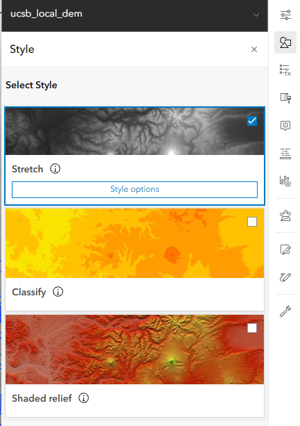

-   insert screenshot of results of divergent DEM

<<<<<<< HEAD
#### Creating Shaded Relief (Hillshade) on the Fly

One use for a DEM is to make a shaded relief layer. That is a classic
view that gives the terrain realistic three-dimensional depth and
surface texture, we can generate a shaded relief visualization
dynamically:

1.  Duplicate the `ucsb_local_dem` layer.
2.  Rename the two DEM layers for clarity: name the top layer
    `Elevation (Color)` and the bottom layer
    `Elevation (Shaded Relief)`.
3.  Change the symbology style to **Shaded Relief**.

Shaded relief simulates how sunlight illuminates terrain, casting
shadows based on the position of the sun measured as two angles: Azimuth
and Altitude

-   **Azimuth**: The compass direction from which the illumination
    source (the sun) originates, measured in degrees clockwise from
    north (0° = North, 90° = East, 180° = South, 270° = West). In
    cartography, the sun is traditionally positioned in the northwest
    (315°) or west (270°) to match how the human brain interprets light
    and shadow, preventing an optical illusion known as "relief
    inversion" where mountains appear as valleys. For our map, we
    position the light source from the west.
-   **Altitude**: The angle of the sun above the horizon, measured from
    0° (level with the horizon at sunrise/sunset) to 90° (directly
    overhead at solar noon). A lower altitude (e.g., 30°–45°, typical of
    low winter sun) produces longer, more dramatic shadows that
    accentuate ridgelines, canyons, and valleys.

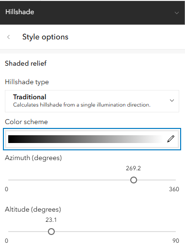

We can adjust those angles to show the sun in the morning or evening
here in Santa Barbara.

Adjust the transparency of the top colored elevation layer so the shaded
relief beneath shows through, creating an illuminated 3D terrain effect
under our roads.

{fig-alt="A rainbow colored hillshaded map with roads showing the software interface"}

This matches interim map 3 in our group.

This is a bit of an artificial example, because Esri offers a wide
variety of hillshade basemaps in the Living Atlas. Also: that was a
rather lengthy aside.

Now would be an excellent point to save your map.
=======
>>>>>>> 9c6f3412c0da36a61849fbb86eefcbe07094194a

### Categorical Rasters

**Categorical vs. Continuous Data**

Continuous data are best represented by numbers, and are logically
consistent when you do so. Smaller numbers = less of some measurement.

On the other hand, categorical data can be text or numeric. The value of
any numbers used do not necessarily reflect any mathematical value, but
it may. For example, while the values below have a natural order (3
Little Piggies Construction Scale), the numbers are ordinal, but
arbitrary:

-   1 = reinforced concrete or steel beam

-   2 = wood stick construction

-   3 = baked brick masonry

-   4 = adobe

-   5 = sun brick / mud daub

-   6 = straw bail

-   While elevation is a **continuous raster** (values change smoothly
    along a numerical gradient), other rasters are **categorical
    rasters** (e.g., land cover classification datasets from the Living
    Atlas, where integer cell values represent categories such as urban
    development, forest, or water).

One particularly arbitrary type of categorical data is land cover. -
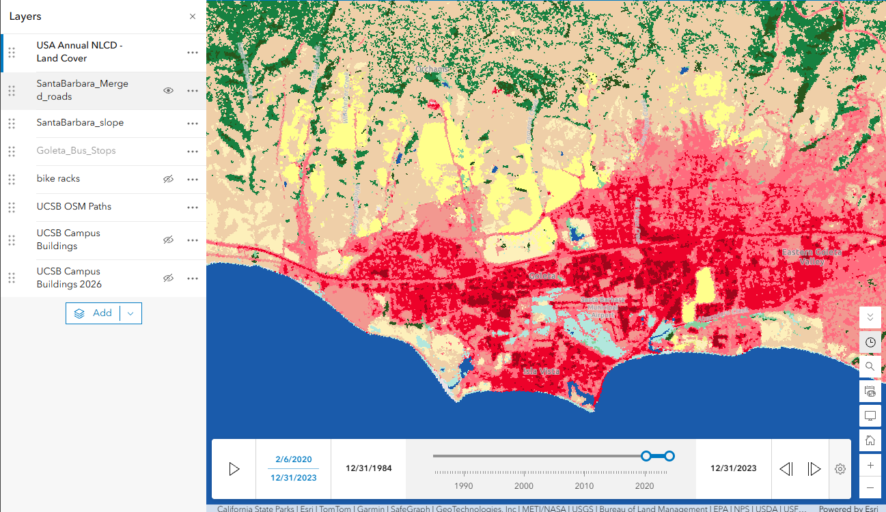

### Calculated Raster Data: Slope

When we made the hillshade visualization above, that was a sort of
calculation based on the DEM.

You can also perform calculations to turn a DEM into a slope layer. We
made this slope layer for you. This is another continuous dataset. You
can call it derivative data.

We will learn how it was made in workshop 3, but for now we will use it
to examine, with our eyes, where the steepest bike routes up into our
foothills are: 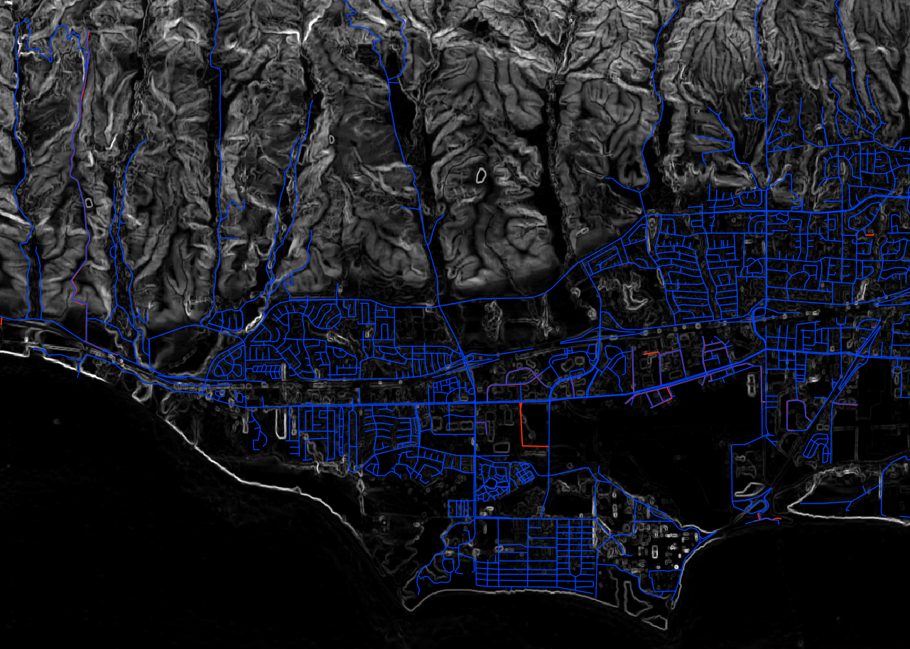

**POP QUIZ:** Below same slope layer, zoomed in to campus, and
symbolized with a divergent color scheme. What does this tell you is
incorrect about something we said earlier regarding our DEM?

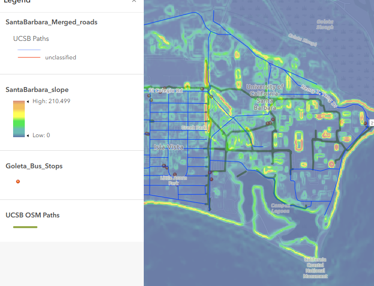

Resymbolize your slope layer to a color scheme that makes sense to you.
Look up into the foothills. Which paths look steepest?

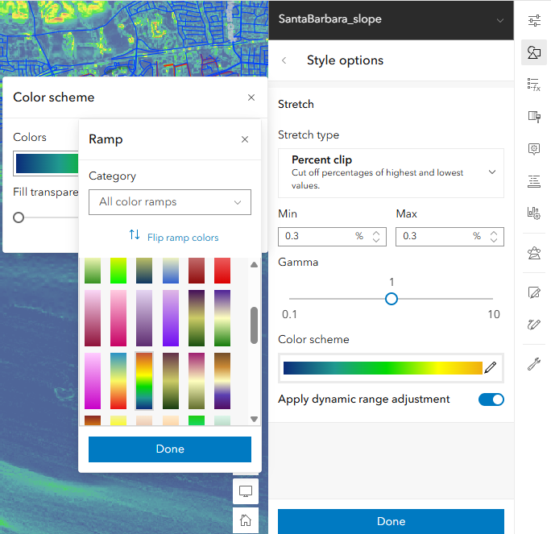{width="60%"}

## Layer Management, Rasters, and Additional Vectors

Add in the bus stop layer

1.  **Re-order layers**: Ensure vector layers (roads and paths) remain
    on top of the raster elevation layers in the layer stack so they are
    not hidden.

2.  **Imagery Layers vs. Basemaps**:

    -   An **basemap** sits at the bottom of the map canvas, serving
        purely as a static background context. Esri has options that are
        satellite and aerial views.
    -   An **imagery layer** is a data layer added to your map stack. It
        can be re-ordered above or below other layers, adjusted with
        transparency and blend modes, queried for pixel values, and
        analyze for groundcover characteristics.
    -   Below we will add a Planet satellite view to campus to explore.

::: callout-note
#### Esri ArcGIS Online Credits

-   All ArcGIS Online accounts created under the UCSB site license are
    allocated **1000 service credits** per license year.
-   **Transactions**: Some analysis operations and storage consume
    service credits. For more information, visit Esri's [Understand
    Credits](https://doc.arcgis.com/en/arcgis-online/administer/credits.htm)
    page.
-   **Manage your content**: Periodically review and delete unnecessary
    hosted layers and analysis outputs to conserve credits.
-   **Data Stewardship**: Objects stored in ArcGIS Online should be
    considered ephemeral. Your content access depends on the UCSB
    Library's Higher Education Site License.
:::

## Multi-band Rasters

So far we have worked with single-channel, or 1-band rasters. However,
perhaps we are more familiar with 3-channel images, because our eyes see
best in the red-green-blue color space. For geospatial data, think of
this as satellite or aerial views.

For digital images, 3 'bands' of wavelengths are stored separately. When
the computer combines them together, we humans see something akin to
what we see when we look at nature with our eyes. However, we can swap
in other bandwidths of radiation, such as near infrared, or microwave,
and see completely other things.

The DREAM Lab hosts several satellite views of campus created by a
private satellite firm. Let's add one of those layers now:

-   placeholder for Planet image of Goleta

## Importing data into ArcGIS Online

Uploading a raster image to ArcGIS Online takes up storage, so we aren't
going to do that. However we can also add vector and tabular data to our
map!

### Creating Vector Layers from .CSV files

In this section we will import `SantaBarbara_County_Trailheads.csv` from
a CSV spreadsheet using coordinate columns (latitude and longitude) to
see how external tabular data can be transformed into a geospatial layer
and integrate with existing road and elevation layers.

Download and open the `SantaBarbara_County_Trailheads.csv` onto your
device.

::: {.callout-tip collapse="true"}
## Challenge - Inspect the trailhead data

-   What are the attributes stored in this dataset?
-   Which attributes are storing the geospatial information?
-   What is the quality of this dataset? Anything suspect?
:::

#### CSV import wizard

-   Add layer from file

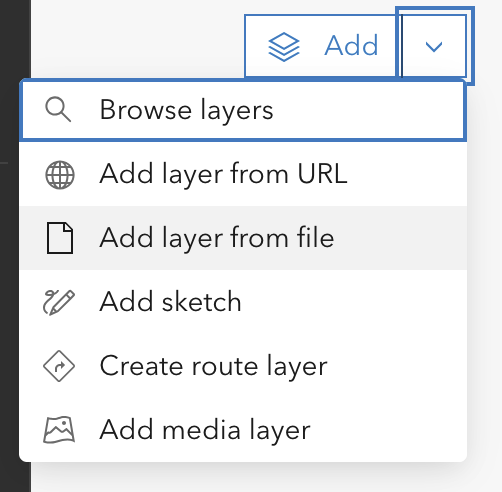{fig-alt="Unfold the Add menu"
width="40%"}

-   Select "Your Device" and browse to the csv file you want to import

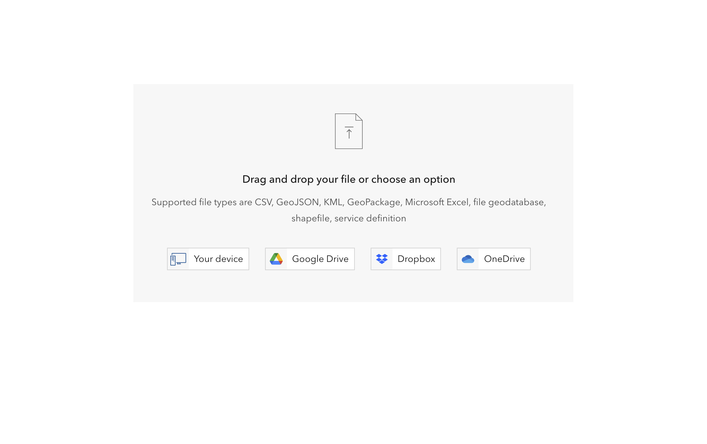{fig-alt="Browse or drop file"
width="80%"}

-   Leave the default option "Create a hosted feature layer and add it
    to the map" and click Next

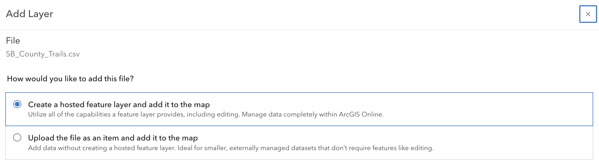{fig-alt="Select 'hosted feature'"
width="80%"}

-   Select the attributes you would like to import as well as rename
    fields as you see necessary. You can also use this step to rename
    any of the field. Let's select all the fields up to "Overview" and
    Rename "Title" as "Name". It is also a good practice to check that
    the field types are aligned with what you were expecting.

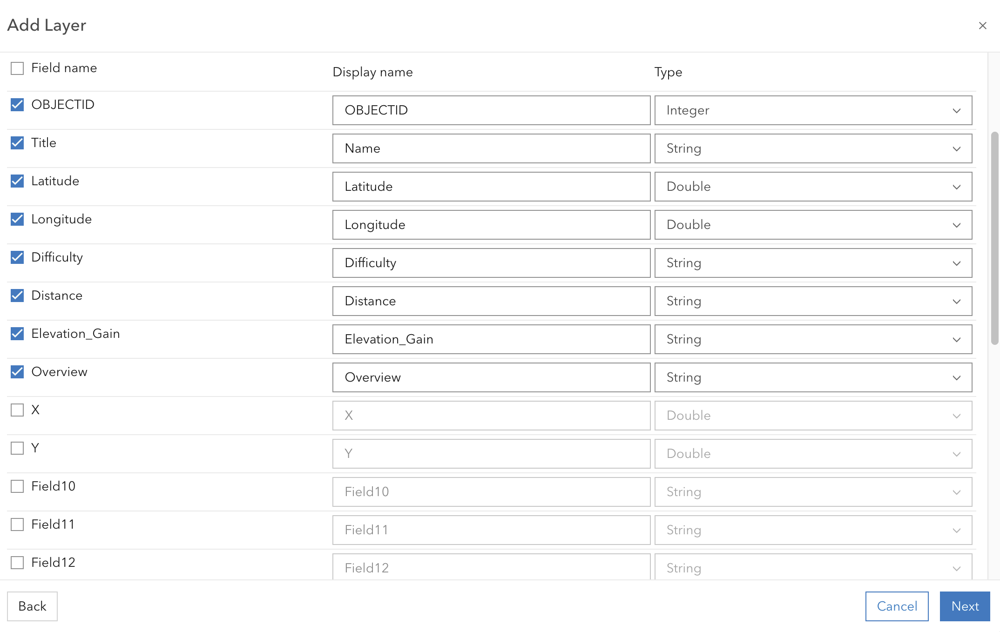{fig-alt="Select the attributes you want to import and rename them as needed"
width="100%"}

-   Match the latitude and longitude information used by ArcGIS to
    generate the location with your data attributes.

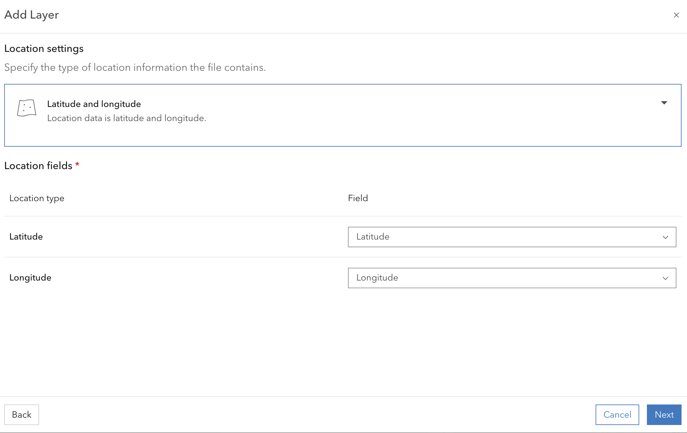{fig-alt="Match the Latitude and longitude attribute from your data with the information that ArcGIS will use to create the spatial locations"
width="80%"}

-   Save your new data layer under your user account creating a
    `ucsb_bike` folder if you have not one yet

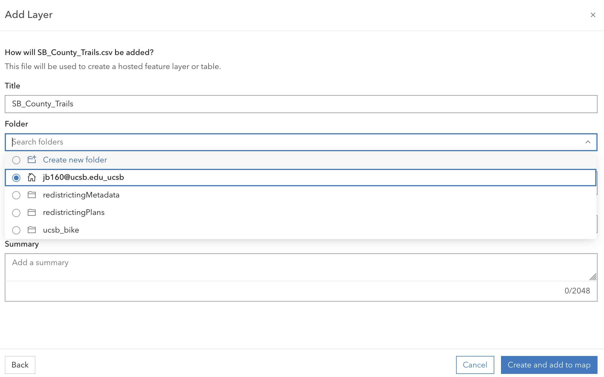{fig-alt="Interface to Save your new layer under your account"
width="80%"}

-   Zoom out to see the trailhead locations! Of course now we need to
    make it look better :)

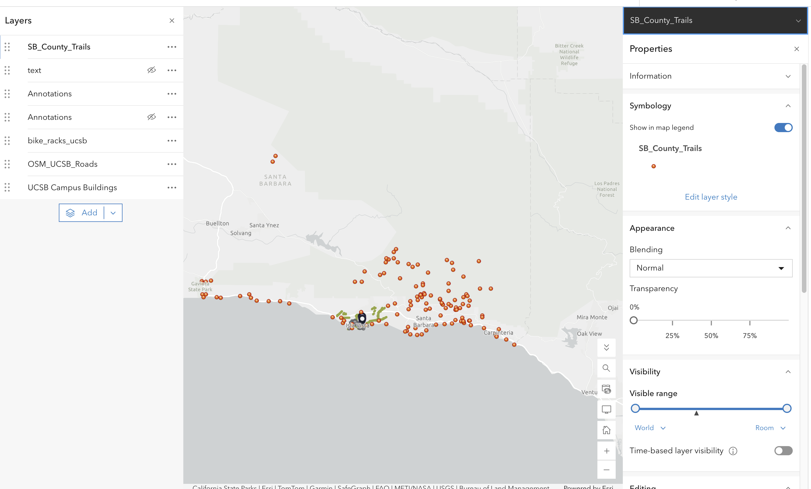{fig-alt="Map displaying the new imported layer about trailheads in the Santa Barbara vicinity"
width="100%"}

::: {.callout-note collapse="false" title="CRS"}
## A note on Coordinate Reference Systems

In ArcGIS Online, the default projection and Coordinate Reference System
(CRS) is WGS 1984 Web Mercator Auxilary Sphere, also used by the Global
Positioning System
([GPS](https://en.wikipedia.org/wiki/Global_Positioning_System)).

Coordinate systems can be divided into two main categories: Projected
and Geographic Coordinate Systems.

-   **Projected** Coordinate Systems use a 2D flat surface to define
    locations and is measured in linear units. Locations are identified
    by x,y coordinates

-   **Geographic** Coordinate Systems use a 3D spherical surface
    measured in angular units to define locations on earth. A point is
    referred by its latitude and longitude.

There are pletor of CRSs that all have different accuracy and other
advantages depending on your location and extenst of your area of
interest. Here is a good website to look at the different CRSs:
<https://epsg.io/>

**Examine the csv file: does it tell you anything about the coordinate
system that we are dealing with?**
:::

::: {.callout-tip collapse="true"}
## Challenge - Make the trailhead layer look nice

-   Choose the trail `Difficulty` attribute to add a color ramp
-   Give a title to the legend
-   Reorder the fields so their are matching the difficulty order (and
    not the alphabetical one)
-   Choose a good color ramp
-   Increase the point size
:::

## Editing Data

Potential narrative: adding the new ILP bike path to your own personal
bike path layer.

## Exporting Data

At some point in your analysis, you might want to also download the data
in addition to your map, for example, to move to a scripted environment
such as R and Python to conduct statistical analysis. This is a
multi-step process: first, you will have to export the feature layer in
a downloadable format; then you will be able to download this layer to
your local computer.

You can not export a layer from the Map Viewer, you will need to first
return to the “My Content” view. You can do this by using the “Burger”
menu at the top-left of your Map view and selecting Content.

-   Once in the My content view, locate and click on the spatial
    trailhead layer you imported from the CSV file to go to the Overview
    page of that layer.

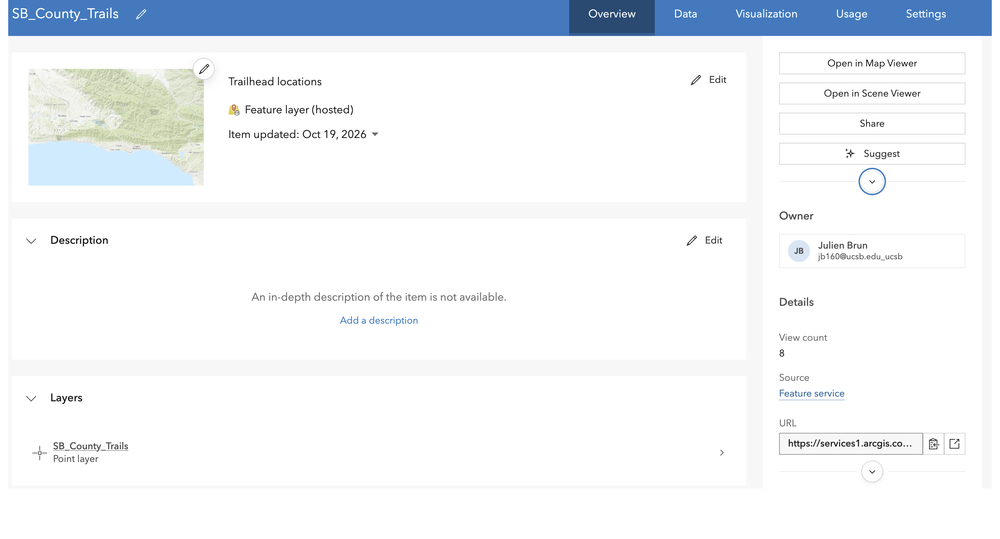{fig-alt="Overview page for the feature layer of Santa Barbara County trailheads."
width="100%"}

-   Unfold the menu on the right completely, select Export data, and
    choose the GeoJSON format.

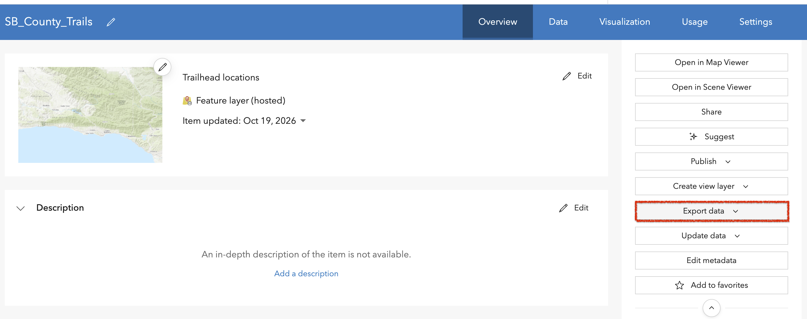{fig-alt="Overview page for the feature layer of Santa Barbara County trailheads with the option menu on the right uncollapsed and showing the Export Data option"
width="100%"}

-   On the next window, leave the default options and choose your
    ucsb_bike folder as location. Click on Export. Note that exporting
    data can take some time, so be patient :)

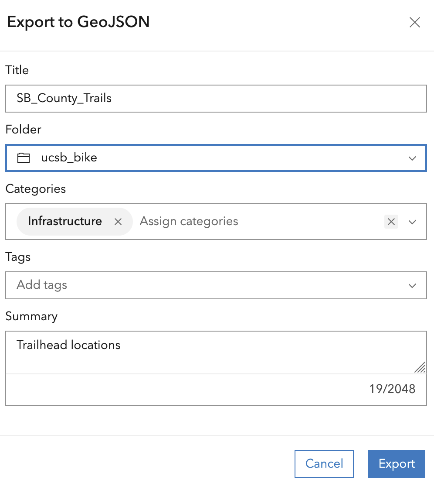{fig-alt="Wizzard page to export a geojson file: title, Folder location, Categories, Tags and Summary are the available options"
width="50%"}

-   Once the export is completed, you should automatically be redirected
    to the Overview page of this new dataset. This time, Download should
    be available in the menu on the right side of the page. Click on it
    and select a location on your local computer and a filename.

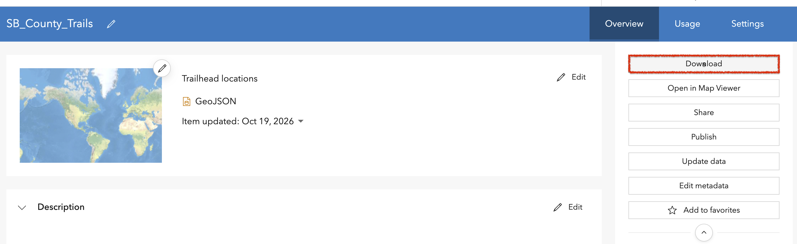{fig-alt="Overview page for the newly created geojson layer. The menu on the right has now the Dowload option avaialble"
width="100%"}

see also: the token economy \<= Call-out box?


## Completing the Story

So where shall we ride our bicycles?


<hr>


## How to improve your map

### Creating Shaded Relief (Hillshade) on the Fly

One use for a DEM is to make a shaded relief layer. That is a classic
view that gives the terrain realistic three-dimensional depth and
surface texture, we can generate a shaded relief visualization
dynamically:

1.  Duplicate the `ucsb_local_dem` layer.
2.  Rename the two DEM layers for clarity: name the top layer
    `Elevation (Color)` and the bottom layer
    `Elevation (Shaded Relief)`.
3.  Change the symbology style to **Shaded Relief**.

Shaded relief simulates how sunlight illuminates terrain, casting
shadows based on the position of the sun measured as two angles: Azimuth
and Altitude

- **Azimuth**: The compass direction from which the illumination source
  (the sun) originates, measured in degrees clockwise from north (0° =
  North, 90° = East, 180° = South, 270° = West). In cartography, the sun
  is traditionally positioned in the northwest (315°) or west (270°) to
  match how the human brain interprets light and shadow, preventing an
  optical illusion known as "relief inversion" where mountains appear as
  valleys. For our map, we position the light source from the west.
- **Altitude**: The angle of the sun above the horizon, measured from 0°
  (level with the horizon at sunrise/sunset) to 90° (directly overhead
  at solar noon). A lower altitude (e.g., 30°–45°, typical of low winter
  sun) produces longer, more dramatic shadows that accentuate
  ridgelines, canyons, and valleys.


We can adjust those angles to show the sun in the morning or evening
here in Santa Barbara.

Adjust the transparency of the top colored elevation layer so the shaded
relief beneath shows through, creating an illuminated 3D terrain effect
under our roads.

{fig-alt="A rainbow colored hillshaded map with roads showing the software interface"}

This matches interim map 3 in our group.

This is a bit of an artificial example, because Esri offers a wide
variety of hillshade basemaps in the Living Atlas. Also: that was a
rather lengthy aside.

Now would be an excellent point to save your map.


## Preview for Workshop 3: Looking Ahead to Spatial Analysis

In Workshop 3, we dive deeper into quantitative spatial analysis. The
data layers we prepared today form the foundation for analyzing terrain
and route difficulty:

```         
- Calculate slope from the DEM (a single-channel continuous raster measuring steepness)
- Overlay slope values onto road segments
- Identify and highlight the steepest climbs (maximum slope)
```

### Analysis Workflow Overview

1.  **Slope Calculation**: Use raster analysis tools to calculate a
    slope raster from the DEM, expressing terrain steepness in degrees
    or percent rise.
2.  **Zonal Statistics as Table**: With the slope raster and the road
    network loaded, run **Raster Analysis \> Zonal Statistics as Table**
    to compute summary statistics (such as the maximum or mean slope)
    for each road line.

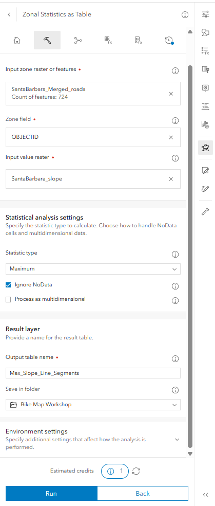

3.  **Joining Statistics to Roads**: The zonal statistics tool outputs a
    standalone data table. To visualize these slope measurements on the
    map, join the table back to the road vector layer using **Tools \>
    Summarize data \> Join Features**, matching on a common identifier
    such as `OBJECTID`.


4.  Once joined, roads can be symbolized by slope steepness, allowing us
    to pinpoint the steepest hill climbs for our ride!

