## Learning Objectives

This lesson focuses on learning more about the different types of
geographic data and learning how to import and work with your own data
in ArcGIS Online. At the end of this workshop you will:

-   Have a better understanding of various vector and raster geospatial
    data types
-   Know how to import external tabular data into ArcGIS Online
-   Know how to edit or add data to a feature layer
-   Better understand the difference between continuous and categorical
    raster layers
-   Know how to export data from ArcGIS Online to your local machine

## Review: Annotations vs. Data

In [Workshop
1](https://rds.library.ucsb.edu/from-maps-to-analysis/01_make_map.html),
we started with sketch layers to draw points, lines, and polygons
directly on top of the map. While sketches are convenient for quick
markups and annotations, they are not true GIS data layers. Sketches
lack an underlying database table and cannot be queried, filtered, or
used in spatial analysis.

In contrast, **feature layers** link geometries (points, lines, or
polygons) to structured records in an **attribute table**. Each feature
has defined attributes, or fields (e.g., name, speed limit, road type,
elevation) with specific data types (such as text strings, numbers, and
dates). This tabular structure makes it possible to filter features,
symbolize data based on its attributes, and calculate spatial
relationships.

### Workshop 1 Recap

Let's start a new map for the larger campus area and its bicycle
infrastructure

1.  Log on to ArcGIS Online
    [**https://ucsb.maps.arcgis.com**](https://ucsb.maps.arcgis.com){target="_blank"}.
    **Sign on with your UCSB NetID**, do not use the ArcGIS login!
2.  Open a new, empty map by clicking `Map` on your top menu bar.
    {#fig-menubar width="90%"
    fig-align="center"}
3.  From the **Layers** panel, click on the **Add** layer button. Search
    `My organization` for **UCSB Campus Buildings 2026**. Choose the top
    result.

::: {.callout-tip collapse="false"}
## Challenge: Workshop 1 Recap

Using the [workshop 1
materials](01_make_map.qmd#step-1-add-layers-to-your-map) as reference,
do the following tasks:

1.  Add symbology to the building layer using the `b_use` column.\
2.  Repeat the above steps to add the feature layer `bike_racks_ucsb` to
    your map.
3.  Experiment with the dot size and color for the bike racks.
4.  Perform a `Save as...` before moving to workshop 2 and name give
    your map a unique name, for example: **Goleta bike map**
5.  If you weren't able to keep up, [open this
    map](https://ucsb.maps.arcgis.com/home/item.html?id=2b16d246ee4c4321852712b9b4652b74#overview)
    and do a `Save as..`.
:::

::: {.callout-note collapse="false"}
#### Save often

Once satisfied, Don't forget to save your map!!

{#fig-saveas-step1
width="30%" fig-align="center"}

Select "Save As" and add a title **"Goleta Trailhead Map -
YourInitials"**, and a short description of your map.
:::

<hr>

## Preview: our end goal

Our finished product for this session will be the
`Workshop Goleta bike map`. We will take time to preview this finished
map before building it step by step.

YES WE KNOW THIS ISN'T HERE YET

\*\* link and screenshot of finished map goes here. [Work in progress
version: (https://arcg.is/1yz0KP3)](https://arcg.is/1yz0KP3)

## Raster vs Vector Data

Geographic data generally falls into two primary models: **vector** and
**raster**.

](images/workshop2/graphicmamacartoon.jpg){fig-alt="A cartoon visually comparing mathematically calculated vectors veersus grids of square pixel rasters"}

### Vector Data

So far we have only looked at vector data. Vector data represents
discrete geographic features using coordinate geometry:

-   **Points**: Single $(X, Y)$ coordinate pairs representing discrete
    locations (e.g., bike racks, bus stops, accident locations).
-   **Lines (Polylines)**: Ordered sequences of vertices connecting
    locations to represent linear features or networks (e.g., bike
    paths, roads, transit routes, streams).
-   **Polygons**: Closed shapes enclosing an area defined by connected
    coordinate vertices (e.g., campus buildings, land parcels, parks,
    water bodies).

Every shape is tied to a row in an attribute table, where each column
holds specific properties describing that feature. For example, in our
Workshop 1 example, we can pop open the attribute table and look at the
attributes (the row) for the "Library" building:

Visually selecting the library building polygon on the map will select
the row in the attribute table.

Then opening the Attribute Table under layer options by clicking Layers
\> UCSB Campus Buldings 2026, the `...` \> Show table

Each polygon in the table has many fields and values associated with it.
Building names, floor counts, area, who edited the file, and when it was
last updated, among other fields a user may find helpful when analyzing
their data.

Attributes may be divided into three types:

-   Nominal: free-text information for labels and names

-   Categorical

-   Numeric: both continuous and ordinal information that can be counted
    or has numerical importance - *ie* the number of floors that each
    building has (note: the UCSB Library has a basement and attic.
    Hence 10) or the area of each building's floorspace.

-   Continuous Numeric: information that can be ordered or ranked in
    some way - floor count

### Raster Data

Raster data represents the landscape as a regular grid of square cells
(pixels) organized into rows and columns.

-   **Single-band rasters**: Each pixel contains a single numerical
    value representing a continuous measurement (such as elevation in a
    Digital Elevation Model \[DEM\], slope, or temperature) or an
    integer code representing a category (such as land cover types).
-   **Multi-band rasters**: Each pixel contains multiple values across
    different spectral channels or bands (such as red, green, blue, and
    near-infrared bands in aerial photography or satellite imagery).

Below is a single band raster. The value of each pixel is elevation.
**INCORRECT – this is the slope map**

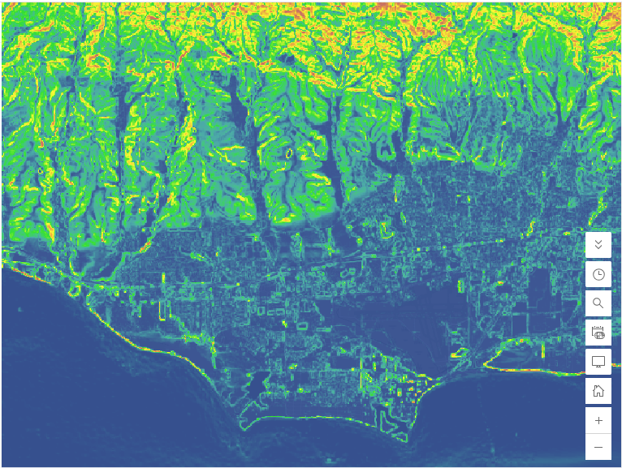

Below is an 8-band raster with band #7 (near IR) as red, band #3 (green)
as green, and band #1 (coastal blue) as blue. This type of image
displays are often called "false-color" because they do not respect the
RGB channel alignment. This can help to highlight some features, such as
vegetation that has a strong signal in near infrared (NIR) wavelengths

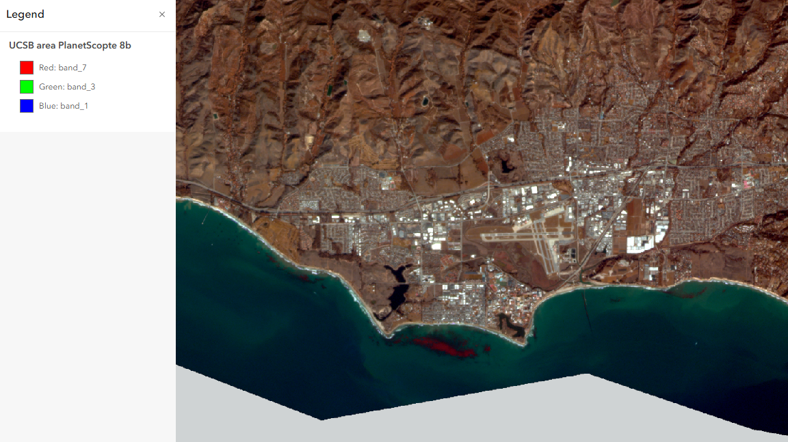

### The Story So Far

In the first workshop, we created a bicycle map of campus and Isla Vista
using pre-existing data.

Our goal for part 2 is to plan a challenging and comfortable bicycle
route that leads from the UCSB campus into the surrounding Goleta
community and the Santa Ynez foothills. Ideally, we want to lock up near
a trailhead, and then put our bike on the bus on the way back to campus.

To accomplish this, we need to expand beyond campus bike paths and
incorporate regional road networks; we want to look at elevation data to
look for steep climbs and long views; and we need to find those bus
stops.

## Exploring Vector Data

### Map Setup

Let's set up our workspaces together. The layers for this workshop all
have a wider extent than those from Workshop 1. For example,
[SantaBarbara_Merged_roads](https://ucsb.maps.arcgis.com/home/item.html?id=6729661d7b8043558c2fe6ada62f0df9){target="_blank"}
is an expanded street and bicycle path network covering the Goleta and
Santa Barbara area, extracted from OpenStreetMap and an Esri Living
Atlas layer. We have already excluded major highways from this layer --
because we know you won't want to bicycle on them.

To examine routes beyond campus, we zoom out to the broader regional
area:

1.  Start with your freshly saved copy of the map in your personal
    workspace.
2.  Add the `SantaBarbara_Merged_roads` layer from your organization or
    the workshop group.
3.  Open the attribute table to inspect fields such as highway
    classification, road surface, and speed limits, and symbolize the
    roads to distinguish bike-friendly streets from arterial highways.
4.  Filter out the bike paths

-   GOTCHA: most of the attribute data is blank. We will leave all of
    the roads turned on.
-   screenshot of map with roads symbolized for bikes. Map 1 currently
    has default blue.

::: {.callout-tip collapse="false"}
### Modify vector symbology

1.  Replace the "<Null>" in the legend with "Bike path"
2.  Increase the line width to 3px
:::

::: callout-note
Keeping a clean workspace

Let's not forget to remove old layers from the current map (ie: the old
roads roads)
:::

{fig-alt="Starting map with UCSB buildings, Bike racks, and local bike paths"
width="90%" fig-align="center"}

## Exploring Raster Data

When outside of ArcGIS Online, geospatial raster data comes in many
different formats. TIFFs, Grids, netCDF, iiif, web map services. Too
many to list!

-   ArcGIS Online variations: while many of these start somewhere as
    TIFFs, they are all ingested into AGO as flavors of
    `Tiled imagery layers`

Let's add a Digital Elevation Model to out map: `ucsb_local_dem`. By
default, a `single channel` or `one band` raster is displayed as
grayscale, with low values black and high values white.

Your map with DEM should look something like this by default:

{fig-alt="By default, DEMs appear as almost black for low elevations to white for high elevations"
width="90%" fig-align="center"}

Each pixel, or cell, in our DEM represents bare-earth surface elevation
relative to a vertical datum (mean sea level). The `ucsb_local_dem`
dataset was derived from a high-resolution USGS LiDAR survey (3D
Elevation Program (3DEP)).

**POP QUIZ:** What do you think are the units of `ucsb_local_dem`?

A DEM is an example of a **continuous raster** as the values stored in
each cell correspond to a quantity gradient (elevation in meters)
changing in space . Other examples of continuous raster would be
precipitation measurements, air quality index, ocean salinity, or
distance from a road.

In the layer properties, explore the raster statistics: note the minimum
elevation near sea level (0) along the coast and slough, rising to
hundreds of feet in the foothills, as well as the grid cell resolution.

::: {.callout-tip collapse="true"}
## Challenge: Does our DEM contain negative values? Why?

## yes. because sea level.
:::

::: {.callout-tip collapse="true"}

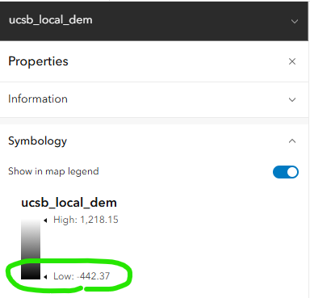

The properties window of a raster will show you the maximum and minimum
values
:::

#### Applying a Continuous Divergent Color Scheme

Data that moves around a zero point, such as our batho-topo elevation
model, is knows as \*\* divergent \*\*. It is very helpful to your map
viewers to visualize this typ of data with a divergent color scheme.

By default, continuous raster layers display using a grayscale "Stretch"
renderer (low values '0' dark, and high values 255 light). To clearly
distinguish elevation changes across the coastal plain and mountains,
let's change the symbology to a continuous, diverging color ramp (e.g.,
a below-and-above zero diverging ramp or an elevation palette). Select
the DEM layer and open the Styles menu
(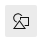)

to use 'Stretch', we have to force zero to be the middle value. When we
need to do this, we look at the DEM's actual minimum and maximum values,
and take whichever number has the larger absolute value. Use that exact
number as both a negative minimum and a positive maximum in the
Statistics table. (e.g.: 1218 feet)

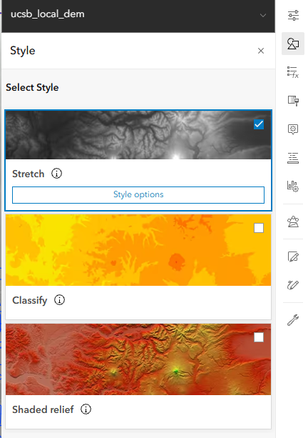

Here is below an example of a widely used color scale for DEM, with
lower elevation display in blue and green and higher elevation in brown
and white.

{fig-alt="Digital Elevation
Model with color scaled for DEM: white a higher elevation, blue and
green for lower elevation"
scale\](images/workshop2/w2_dem_colored.png){fig-alt="Digital Elevation
Model with color scaled for DEM: white a higer elevation, blue and green
for lower elevation" width="90%" fig-align="center"}

#### 'Binning' a raster

It's sometimes easier to divide a raster into classes. You can do this
on the fly in ArcGIS Online by changing the symbology, first to 'Natural
Breaks,' and then customized to highlight the near-zero areas around the
coast

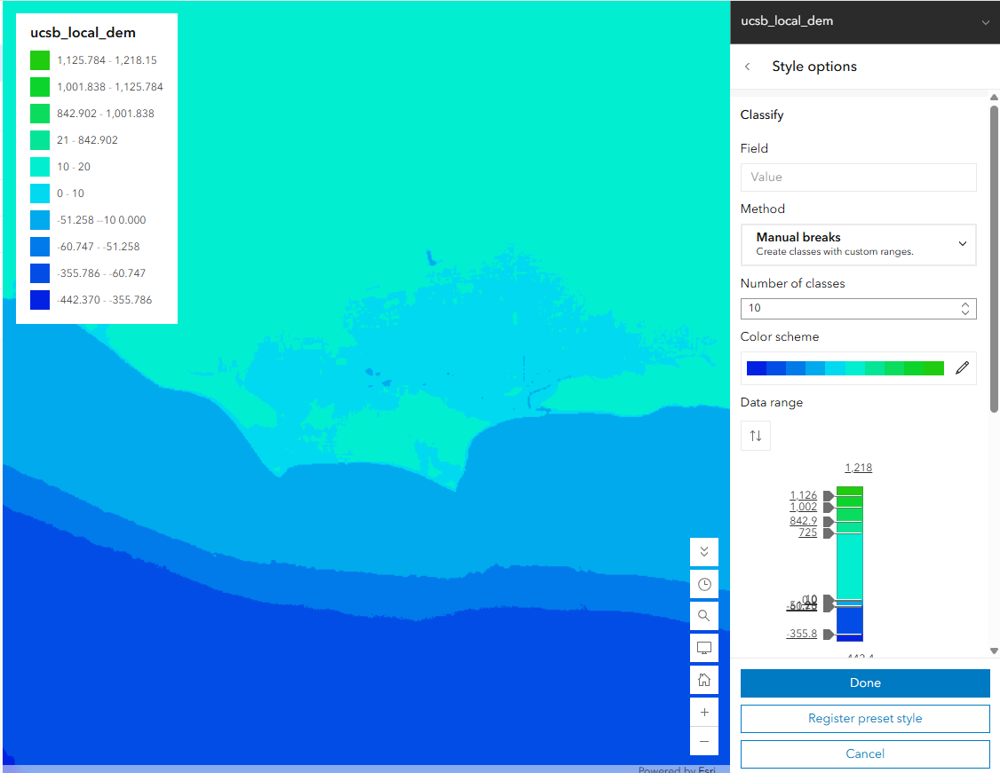....

### Calculated Raster Data: Slope

You can also perform calculations to turn a DEM into a slope layer. We
already made this slope layer for you as it can be a computing intensive
task. This is another continuous dataset. You can call it derivative
data.

We will learn how it was made in workshop 3, but for now we will use it
to examine, with our eyes, where the steepest bike routes up into our
foothills are. Add this raster layer by searching for
`SantaBarbara_slope` within the UCSB organization:

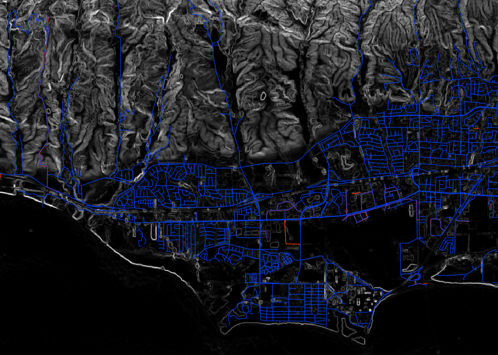

**POP QUIZ:** Below same slope layer, zoomed in to campus, and
symbolized with a divergent color scheme. What does this tell you is
incorrect about something we said earlier regarding our DEM? (DTM vs
DSM)

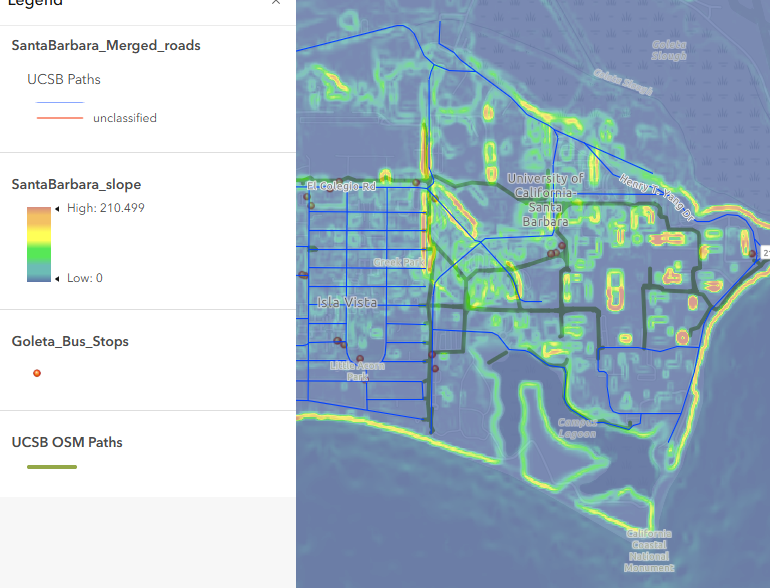

Resymbolize your slope layer to a color scheme that makes sense to you.
Look up into the foothills. Which paths look steepest for our
theoretical bike ride?

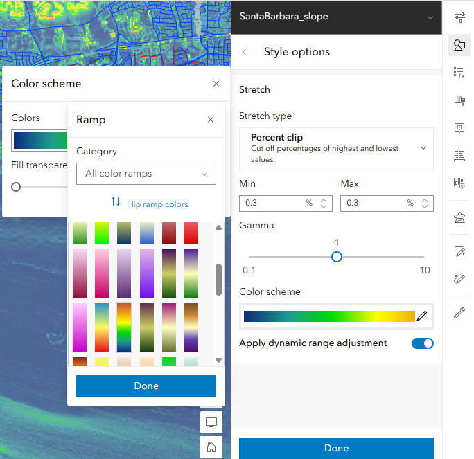{width="60%"}

### Categorical Rasters - Land Cover

**Categorical vs. Continuous Data**

Continuous data are best represented by numbers, and are logically
consistent when you do so. Smaller numbers = less of some measurement.

On the other hand, categorical data can be text or numeric. The value of
any numbers used do not necessarily reflect any mathematical value, but
it may. For example, while the values below have a natural order (The 3
Little Piggies Construction Scale), the numbers are *ordinal* but
arbitrary:

-   1 = reinforced concrete or steel beam
-   2 = wood stick construction
-   3 = baked brick masonry
-   4 = adobe
-   5 = sun brick / mud daub
-   6 = straw bail

While elevation is a **continuous raster** (values change smoothly along
a numerical gradient representing a quantity), other rasters are
**categorical rasters** (e.g., land cover classification datasets from
the Living Atlas, where integer cell values represent categories such as
urban development, forest, or water).

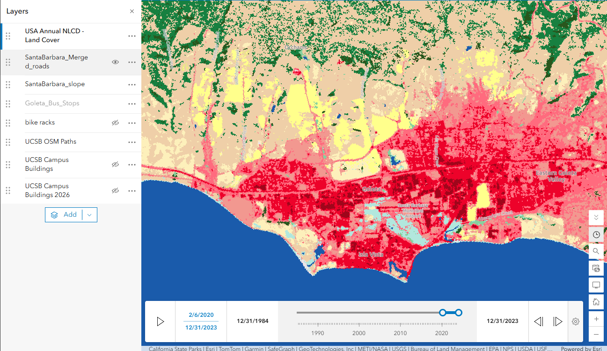

Show the legend to see the category names. Open the attribute table to
compare it to what appears for vector data:

### Multi-band Rasters

So far we have worked with single-channel, or 1-band rasters. However,
perhaps we are more familiar with 3-channel images, because our eyes see
best in the red-green-blue color space. For geospatial data, think of
this as satellite or aerial views.

For digital images, 3 'bands' of wavelengths are stored separately. When
the computer combines them together, we humans see something akin to
what we see when we look at nature with our eyes. However, we can swap
in other bandwidths of radiation, such as near infrared, or microwave,
and see completely other things.

The DREAM Lab hosts several satellite views of campus created by Planet
Labs, a private satellite firm. Its fleet of PlanetScope satellites
captures imagery in 8 bandwidth divisions of the electromagnetic
spectrum. 8-band images. Let's add one of those layers now:

**placeholder for Planet image of Goleta**

## Layer Management, Rasters, and Additional Vectors

1.  **Re-order layers**: Ensure vector layers (roads and paths) remain
    on top of the raster elevation layers in the layer stack so they are
    not hidden.

2.  **Imagery Layers vs. Basemaps**:

    -   An **basemap** sits at the bottom of the map canvas, serving
        purely as a static background context. Esri has options that are
        satellite and aerial views.
    -   An **imagery layer** is a data layer added to your map stack. It
        can be re-ordered above or below other layers, adjusted with
        transparency and blend modes, queried for pixel values, and
        analyze for groundcover characteristics.

**Time to save our map!!!**

::: callout-note
## Esri ArcGIS Online Credits

-   All ArcGIS Online accounts created under the UCSB site license are
    allocated **1000 service credits** per license year.
-   **Transactions**: Some analysis operations and storage consume
    service credits. For more information, visit Esri's [Understand
    Credits](https://doc.arcgis.com/en/arcgis-online/administer/credits.htm)
    page.
-   **Manage your content**: Periodically review and delete unnecessary
    hosted layers and analysis outputs to conserve credits.
-   **Data Stewardship**: Objects stored in ArcGIS Online should be
    considered ephemeral. Your content access depends on the UCSB
    Library's Higher Education Site License.
:::

Its initial appearance is dark -- work on its visualization. Here are
some good settings to use:

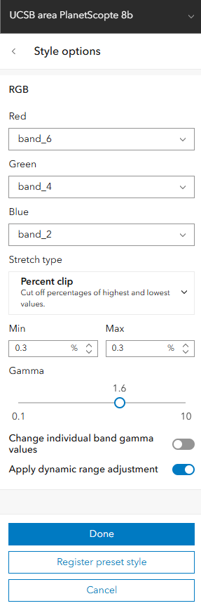{fig-alt="settings as they appear in the lesson text."}

Showing bands 6, 4, and 2 as Red, Green, and Blue respectively will give
a good approximation of human vision. `Gamma` is a degree of adjustment
which changes the mathematics of the values of pixels into ranges that
match the combination of computer monitors and the human eye. Adjust
this so that it appears most natural on your screen.

::: callout-tip
## Challenge: play with different band combinations. What do you think Band

1 is good for?
:::

-   Needs a better question and explanations \*

### Layer Management and Rasters

1.  **Re-order layers**: Ensure vector layers (roads and paths) remain
    on top of the raster elevation layers in the layer stack so they are
    not hidden.
2.  **Imagery Layers vs Basemaps**:
    -   A **basemap** sits at the bottom of the map canvas, serving
        purely as a static background context. Esri has options that are
        satellite and aerial views. You cannot perform analysis on
        basemaps.
    -   An **imagery layer** is a data layer added to your map stack. It
        can be re-ordered above or below other layers, adjusted with
        transparency and blend modes, queried for pixel values, and
        analyze for ground cover characteristics.

At this point your map should look something like this:

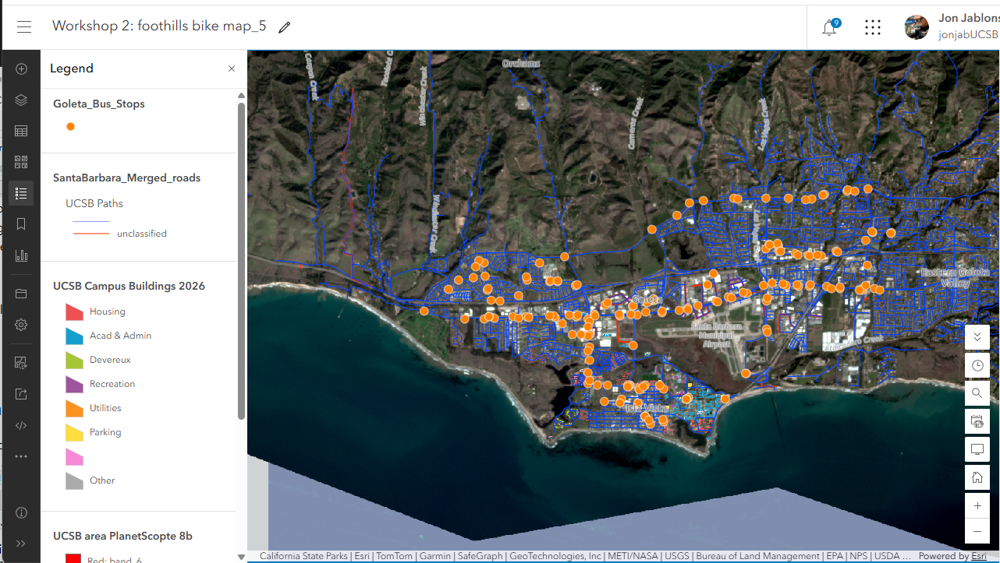

**Time to save our map!!!**

<hr>

## Importing data into ArcGIS Online

::: callout-note
## Esri ArcGIS Online Credits

-   All ArcGIS Online accounts created under the UCSB site license are
    allocated **1000 service credits** per license year.
-   **Transactions**: Some analysis operations and storage consume
    service credits. For more information, visit Esri's [Understand
    Credits](https://doc.arcgis.com/en/arcgis-online/administer/credits.htm)
    page.
-   **Manage your content**: Periodically review and delete unnecessary
    hosted layers and analysis outputs to conserve credits.
-   **Data Stewardship**: Objects stored in ArcGIS Online should be
    considered ephemeral. Your content access depends on the UCSB
    Library's Higher Education Site License.
:::

Uploading a raster image to ArcGIS Online takes up storage, so we aren't
going to do that. However we can also add vector and tabular data to our
map!

### Creating Vector Layers from .CSV files

In this section we will import `SantaBarbara_County_Trailheads.csv` from
a CSV (like a spreadsheet) that includes coordinate columns (latitude
and longitude) of the sort that would come from a GPS device. This will
demonstrate\
how external tabular data can be transformed into a geospatial layer and
integrate with existing road and elevation layers. And seeing where
trailheads are can give us a goal for our bicycle ride!

**Download and open the
[`SantaBarbara_County_Trailheads.csv`](https://github.com/UCSB-Library-Research-Data-Services/from-maps-to-analysis/blob/main/source_data/SB_County_Trails.csv){target="_blank"}
onto your device.**

::: {.callout-tip collapse="true"}
## Challenge - Inspect the trailhead data

-   What are the attributes stored in this dataset?
-   Which attributes are storing the geospatial information?
-   What is the quality of this dataset? Anything suspect?
:::

#### CSV import wizard

-   Add layer from file

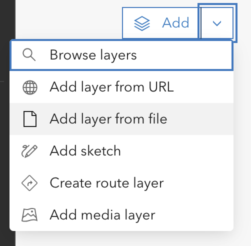{fig-alt="Unfold the Add menu"
width="40%"}

-   Select "Your Device" and browse to the csv file you want to import

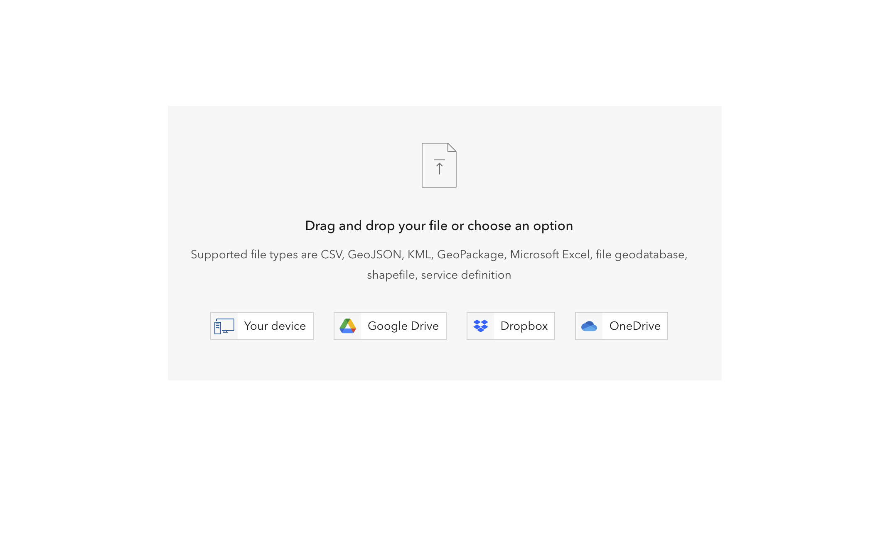{fig-alt="Browse or drop file"
width="80%"}

-   Leave the default option "Create a hosted feature layer and add it
    to the map" and click Next

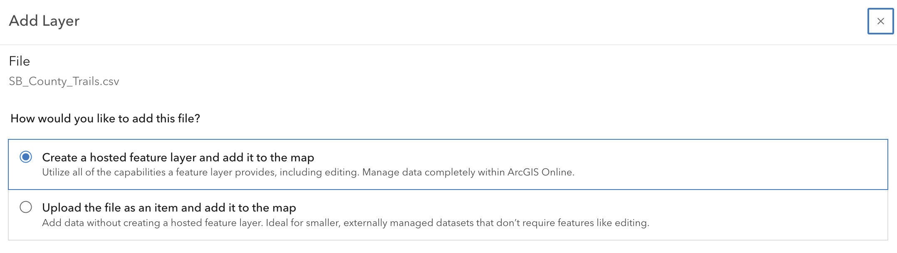{fig-alt="Select 'hosted feature'"
width="80%"}

-   Select the attributes you would like to import as well as rename
    fields as you see necessary. You can also use this step to rename
    any of the field. Let's select all the fields up to "Overview" and
    Rename "Title" as "Name". It is also a good practice to check that
    the field types are aligned with what you were expecting.

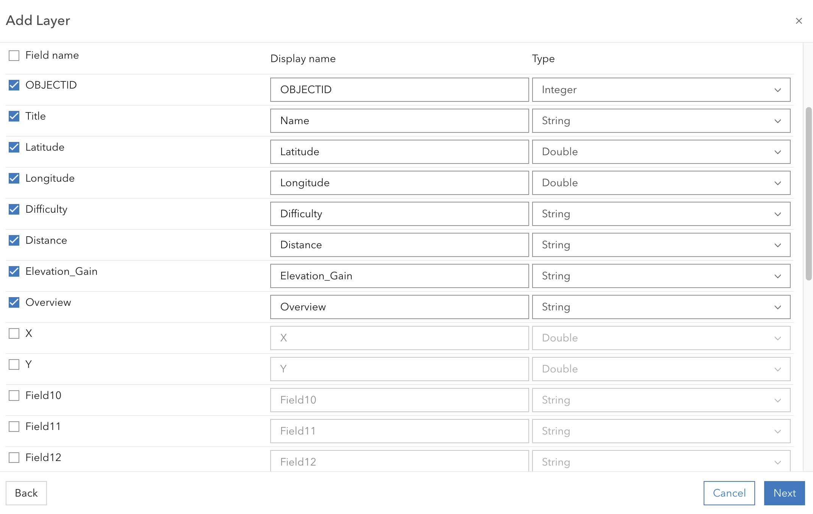{fig-alt="Select the attributes you want to import and rename them as needed"
width="100%"}

-   Match the latitude and longitude information used by ArcGIS to
    generate the location with your data attributes.

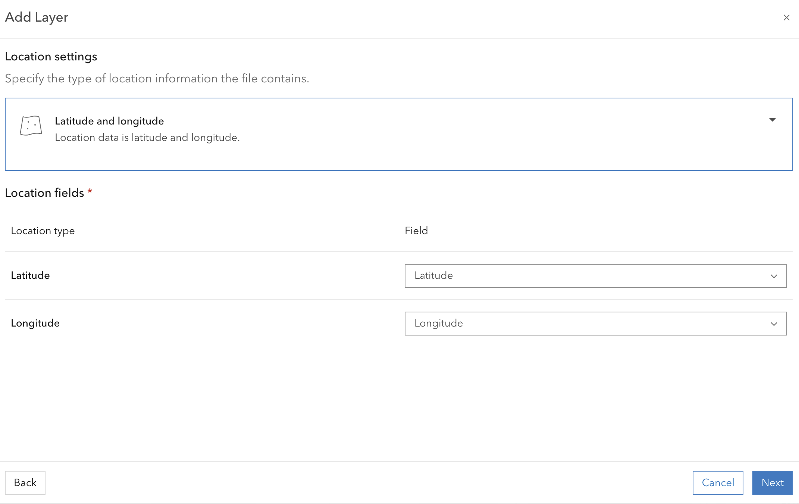{fig-alt="Match the Latitude and longitude attribute from your data with the information that ArcGIS will use to create the spatial locations"
width="80%"}

-   Save your new data layer under your user account creating a
    `ucsb_bike` folder if you have not one yet

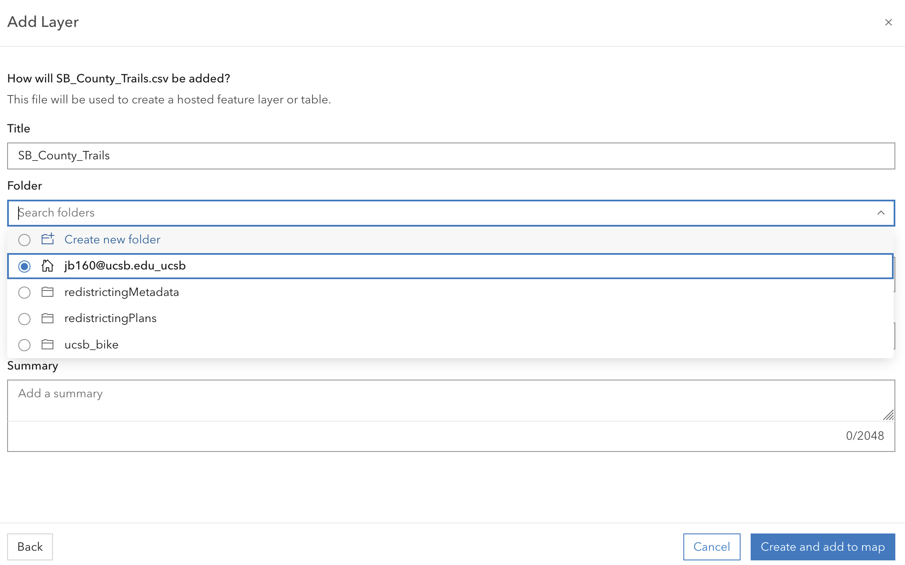{fig-alt="Interface to Save your new layer under your account"
width="80%"}

-   Zoom out to see the trailhead locations! Of course now we need to
    make it look better :)

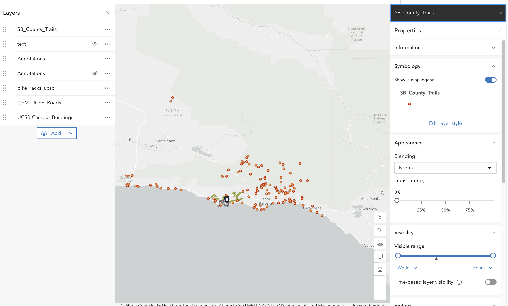{fig-alt="Map displaying the new imported layer about trailheads in the Santa Barbara vicinity"
width="100%"}

::: {.callout-note collapse="false" title="CRS"}
### A note on Coordinate Reference Systems

In ArcGIS Online, the default projection and Coordinate Reference System
(CRS) is WGS 1984 Web Mercator Auxiliary Sphere (also referred as
[EPSG:3857](https://epsg.io/3857))

Coordinate systems can be divided into two main categories: Projected
and Geographic Coordinate Systems.

-   **Projected** Coordinate Systems use a 2D flat surface to define
    locations and is measured in linear units. Locations are identified
    by x,y coordinates

-   **Geographic** Coordinate Systems use a 3D spherical surface
    measured in angular units to define locations on earth. A point is
    referred by its latitude and longitude.

There are plethora of CRSs that all have different accuracy and other
advantages depending on your location and extent of your area of
interest. Here is a good website to look at the different CRSs:
<https://epsg.io/>
:::

**POP QUIZ:** Examine the csv file - does it tell you anything about the
coordinate system that we are dealing with?

::: {.callout-tip collapse="false"}
## Challenge - Make the trailhead layer look nice

-   Choose the trail `Difficulty` attribute to add a color ramp
-   Reorder the categories so their are matching the difficulty order
    (and not the alphabetical one)
-   Choose a good color ramp, e.g. green-yellow for easy-moderate and
    red-purple for difficult
-   Increase the point size to 12px
-   Give a title to the legend "Trail difficulty"
:::

In the end, you should have a legend similar to the following:

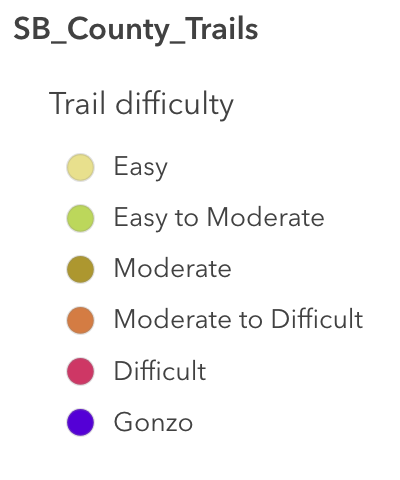{fig-alt="Legend for trailheads with color ranging from yellow - green for easy moderate to red purple for harder ones"
width="30%"}

<hr>

## Editing Vector Data

Now that we have imported data into ArcGIS Online, we might also want to
modify this data. For vector data, we can modify the AGO Feature Layer
attributes and values stored in the underlying table or the feature
itself by editing locations and shapes, or adding and removing specific
features. For raster data, those transformations are generally done
using some form of calculation on the entire raster, or specific values
targeted via conditions, rather than by manually editing pixel values.
We will talk more about raster calculations in our third workshop. For
today, we will focus on editing vector data (or feature layers in ArcGIS
jargon) in this workshop.

::: {.callout-warning collapse="false"}
## This goes beyond the map

It is important to understand that when we are editing a feature layer,
it is independent of the map. You are actually changing the data stored
under your content.

This also means that you might not have the right to edit some of the
data you are using in your map because you do not own them! A potential
workaround is to create a local copy of the data, but some data provider
do not allow this either.
:::

### Editing Features

We noticed that some locations of trailhead on the Goleta Beach Park,
east of campus, are in the ocean. This is probably due to some
imprecision of the GPS measurements. We thus want to move those points
back to the beach

{fig-alt="Trailheads in ocean (red dots) that we would like to move back to the shore (sand dots)"
width="90%"}

To edit a feature layer, need:

1.  To make sure that the layer is selected (name in bold) in the layer
    panel on the left
2.  In the toolbar on the right, click on the edit icon
    {fig-alt="Edit icon that looks like a pencil across a square"
    width="5%"} to start the edit mode

This should open the Editor panel on the right of your map

{fig-alt="Feature layer Editor panel"
width="40%"}

The top part (in red) of this panel lets you edit the feature layer
elements. Below, you can add new features to existing layers (for our
trailhead layer in magenta).

Since we want to move our trailhead locations individually, we can use
the `Select by point` tool (next to the hand) to:

1.  Select a point of interest by clicking on it.

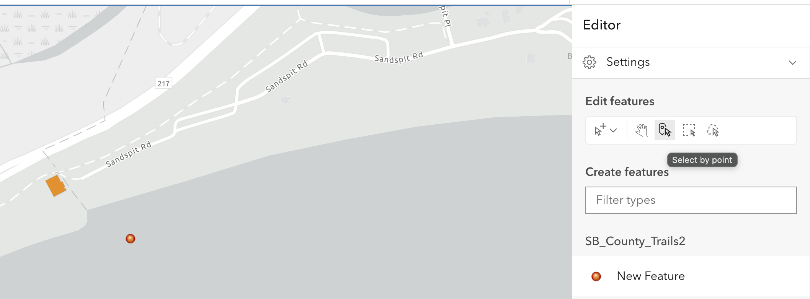{fig-alt="Select by Point tool"
width="90%" fig-align="center"}

2.  Once selected, the dot should have a cyan halo around it and you
    should see its values for the attributes on the right.

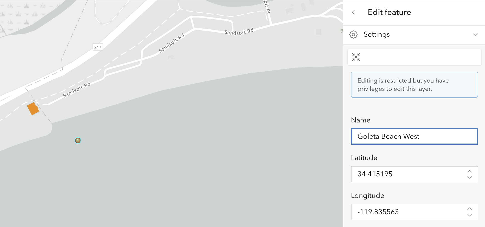{fig-alt="Trailhead in the ocean selected"
width="90%" fig-align="center"}

3.  Then drag the point to the new location, close by the building.

4.  Confirm the change, by clicking on the blue "Update" button at the
    bottom of the panel.

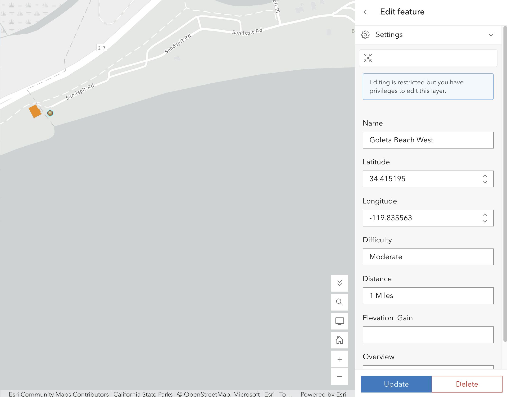{fig-alt="Trailhead location moved to the beach"
width="90%" fig-align="center"}

You have edited the layer! **Note that if it is a layer used in multiple
maps (by you or others you have shared it with), all the maps will be
updated as well, because remember maps and layers are two separate
entities.**

::: {.callout-tip collapse="true"}
## Challenge - Move the other point to the beach!
:::

### Adding a New Feature

Looking around UCSB campus location, we realized that there is no point
for the campus lagoon trail!! Let's add it to the map. We will decide
that the trail starts next to the marine lab.

To add a point to our trailhead layer:

1.  Click on `New Feature` in the edit panel for this layer
2.  Your cursor should become a cross, click on the map to place your
    point
3.  Fill out the information for this new point (leave lat/long blank)
4.  Hit "Create" to add your new feature to the layer

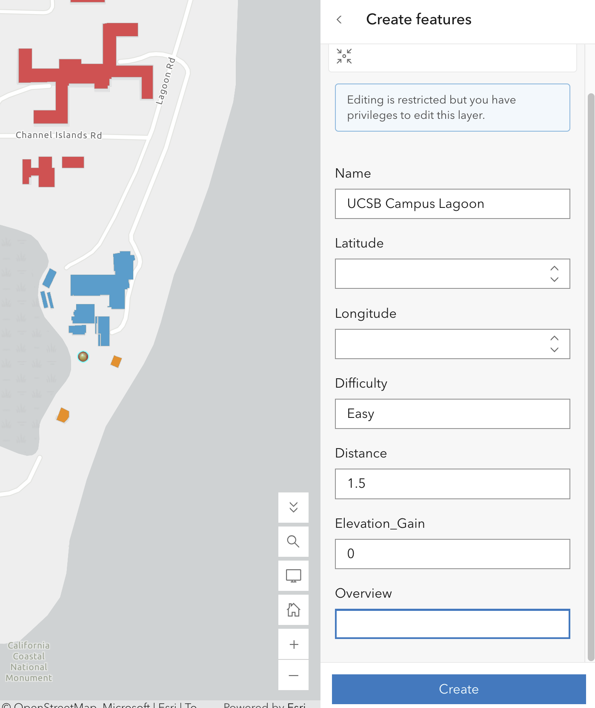{fig-alt="Add new feature point next to the UCSB Marine lab"
width="70%" fig-align="center"}

Make sure to get out of the `Create features` mode before clicking again
on the map!

::: {.callout-note collapse="false"}
Note that the geospatial information used by ArcGIS online to display
the point is **not** store in the attribute table. This is why the
Latitude and Longitude values could be left blank and the point still
being displayed!
:::

### Editing the Attribute Table

You can also edit the information underlying the data by directly
modifying the table. You can add/remove attributes as well as directly
editing the values.

#### Adding an attribute

Now that we have added a new trailhead, we might want to add a new
attribute that will let us track if a specific point is from the
original dataset or something that we have added. You can add an
attribute using the `Field` tool on the right
{fig-alt="Field icon that looks like text with a bar at the bottom"
width="5%"}. This should open a new panel listing all the current fields
and at the button you should see an `+ Add field` button.

1.  Click on it
2.  Choose "Numeric" -\> "Integer" & click "Next"
3.  Enter the following values & click "Add field"

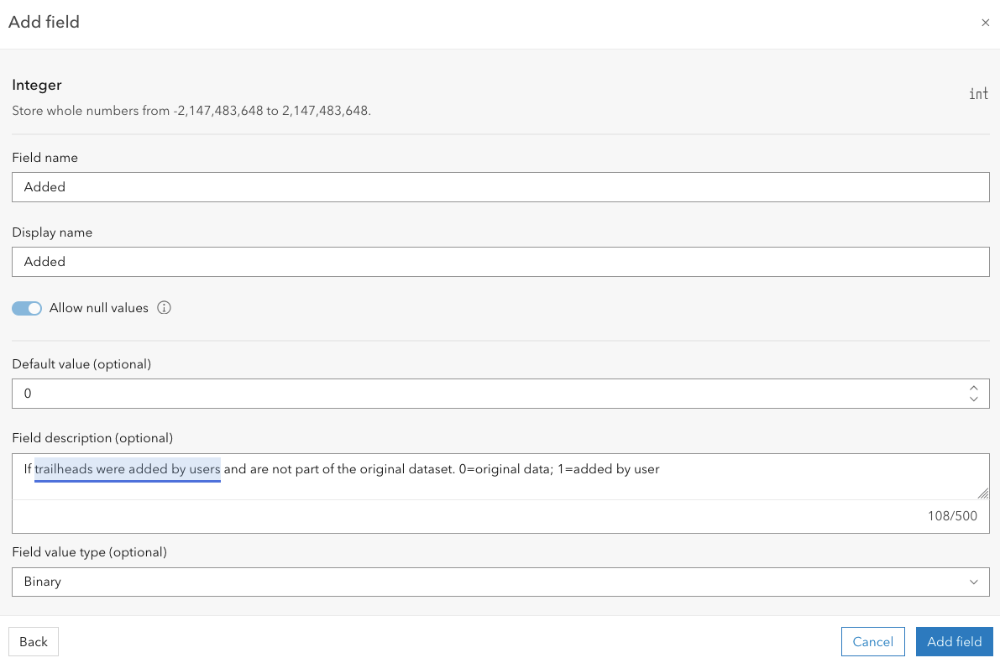{fig-alt="Parameters used to create the new field"
width="90%"} Now you should have the "Added" field listed in the field
list on the right panel.

#### Editing values

Let's open the table to have a look at the values.

The new field has been added as the last column. The point we created
should be at the bottom of the table, as the last row.

There are two ways to edit values in a table. You can double-click on a
cell and change the values, or you can use the pen logo at the end of
the rows that will open back the "Edit Feature" pane we used previously.
Let's directly modify the values by double-clicking in the new "Added"
column and setting the value to 1. Also notice that the other "Distance"
values all have a unit, let's add Miles to the 1.5 we entered
previously.

{fig-alt="Attribute table with the newly entered values"
width="100%" fig-align="center"}

Of course, there are more advanced ways to edit values than cell by
cell. One of them is using the filed calculator that let's you use
expressions (conditions, formulas, ...) to calculate values of a field.
We do not have time to tackle this topic today, But see
[here](https://doc.esri.com/en/arcgis-online/latest/manage-data/calculate-fields.html)
for more information on how to do this.

Here is an example of using the field calculator to select trails that
has been added by users:

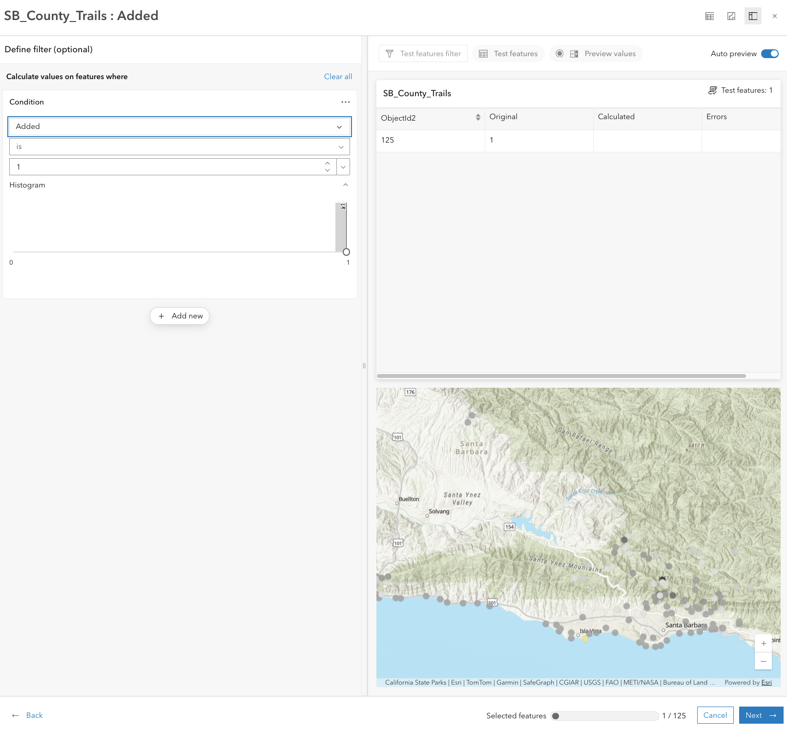{fig-alt="Example of using the field calculator showing the preview of a query"
width="100%" fig-align="center"}

<hr>

## Exporting Data

At some point in your analysis, you might want to also download the data
in addition to your map, for example, to move to a scripted environment
such as R and Python to conduct statistical analysis. This is a
multi-step process: first, you will have to export the feature layer in
a downloadable format; then you will be able to download this layer to
your local computer.

You can not export a layer from the Map Viewer, you will need to first
return to the “My Content” view. You can do this by using the “Burger”
menu at the top-left of your Map view and selecting Content.

-   Once in the My content view, locate and click on the spatial
    trailhead layer you imported from the CSV file to go to the Overview
    page of that layer.

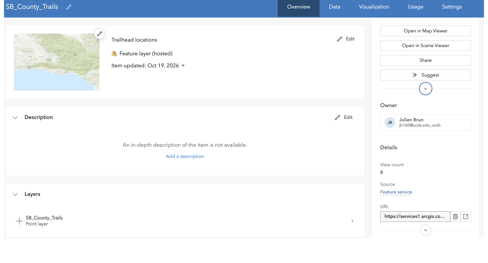{fig-alt="Overview page for the feature layer of Santa Barbara County trailheads."
width="100%"}

-   Unfold the menu on the right completely, select Export data, and
    choose the GeoJSON format.

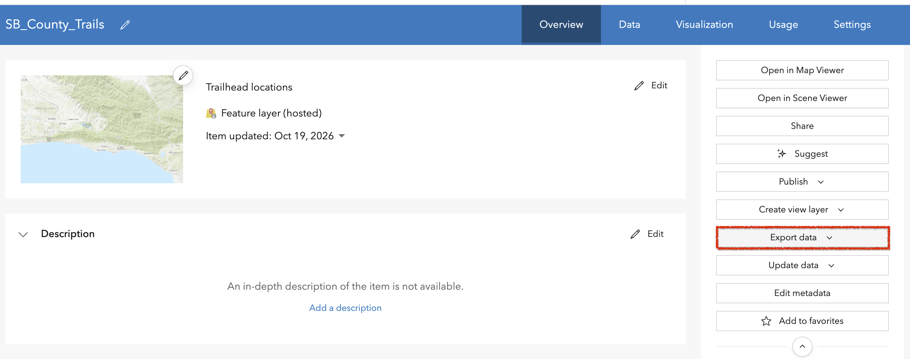{fig-alt="Overview page for the feature layer of Santa Barbara County trailheads with the option menu on the right uncollapsed and showing the Export Data option"
width="100%"}

-   On the next window, leave the default options and choose your
    ucsb_bike folder as location. Click on Export. Note that exporting
    data can take some time, so be patient :)

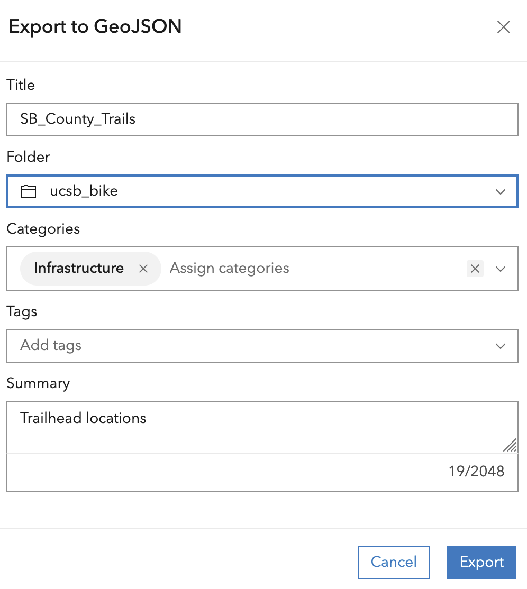{fig-alt="Wizard page to export a geojson file: title, Folder location, Categories, Tags and Summary are the available options"
width="50%"}

-   Once the export is completed, you should automatically be redirected
    to the Overview page of this new dataset. This time, Download should
    be available in the menu on the right side of the page. Click on it
    and select a location on your local computer and a filename.

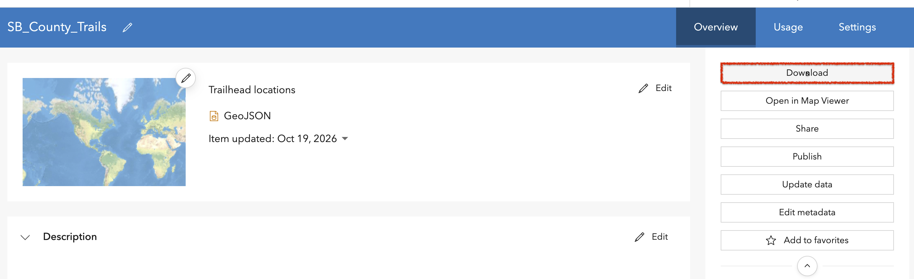{fig-alt="Overview page for the newly created geojson layer. The menu on the right has now the Download option available"
width="100%"}

## Completing the Story

So where shall we ride our bicycles? Keep working on your map to best
display the information we have gathered at this point to further
develop your map to help you decide to which trailheads you could ride
your bike to!

Here is an example of what such map could look like and a few tips below
on how to get started.

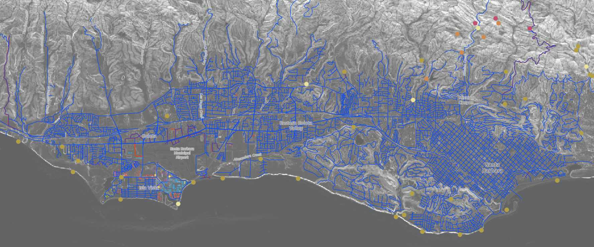{fig-alt="Potential final map shoing the slope in grayscale,  trailheads in color coded dots and the bikable roads in blue"
width="100%"}

### How to improve your map

#### Creating Shaded Relief (Hillshade) on the Fly

One use for a DEM is to make a shaded relief layer. That is a classic
view that gives the terrain realistic three-dimensional depth and
surface texture, we can generate a shaded relief visualization
dynamically:

1.  Duplicate the `ucsb_local_dem` layer.
2.  Rename the two DEM layers for clarity: name the top layer
    `Elevation (Color)` and the bottom layer
    `Elevation (Shaded Relief)`.
3.  Change the symbology style to **Shaded Relief**.

Shaded relief simulates how sunlight illuminates terrain, casting
shadows based on the position of the sun measured as two angles: Azimuth
and Altitude

-   **Azimuth**: The compass direction from which the illumination
    source (the sun) originates, measured in degrees clockwise from
    north (0° = North, 90° = East, 180° = South, 270° = West). In
    cartography, the sun is traditionally positioned in the northwest
    (315°) or west (270°) to match how the human brain interprets light
    and shadow, preventing an optical illusion known as "relief
    inversion" where mountains appear as valleys. For our map, we
    position the light source from the west.
-   **Altitude**: The angle of the sun above the horizon, measured from
    0° (level with the horizon at sunrise/sunset) to 90° (directly
    overhead at solar noon). A lower altitude (e.g., 30°–45°, typical of
    low winter sun) produces longer, more dramatic shadows that
    accentuate ridge lines, canyons, and valleys.

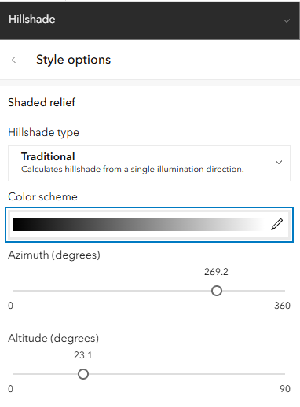

We can adjust those angles to show the sun in the morning or evening
here in Santa Barbara.

Adjust the transparency of the top colored elevation layer so the shaded
relief beneath shows through, creating an illuminated 3D terrain effect
under our roads.

{fig-alt="A rainbow colored hillshaded map with roads showing the software interface"}

This matches interim map 3 in our group.

This is a bit of an artificial example, because Esri offers a wide
variety of hillshade basemaps in the Living Atlas. Also: that was a
rather lengthy aside.

Now would be an excellent point to save your map.

<hr>

## Preview for Workshop 3: Looking Ahead to Spatial Analysis

In Workshop 3, we dive deeper into quantitative spatial analysis. The
data layers we prepared today form the foundation for analyzing terrain
and route difficulty:

```         
- Calculate slope from the DEM (a single-channel continuous raster measuring steepness)
- Overlay slope values onto road segments
- Identify and highlight the steepest climbs (maximum slope)
```

### Analysis Workflow Overview

1.  **Slope Calculation**: Use raster analysis tools to calculate a
    slope raster from the DEM, expressing terrain steepness in degrees
    or percent rise.
2.  **Zonal Statistics as Table**: With the slope raster and the road
    network loaded, run **Raster Analysis \> Zonal Statistics as Table**
    to compute summary statistics (such as the maximum or mean slope)
    for each road line.

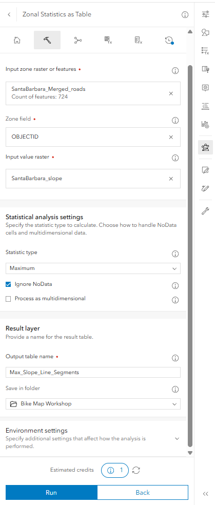

3.  **Joining Statistics to Roads**: The zonal statistics tool outputs a
    standalone data table. To visualize these slope measurements on the
    map, join the table back to the road vector layer using \*\*
    Analysis \> Tools \> Summarize data \> Join Features\*\*, matching
    on a common identifier such as `OBJECTID` (which is often hidden by
    default).

**HAS ANYONE SOLVED THIS? BECAUSE THAT WOULD BE SUPER HELPFUL!!!!!**


4.  Once joined, roads can be symbolized by slope steepness, allowing us
    to pinpoint the steepest hill climbs for our ride!
