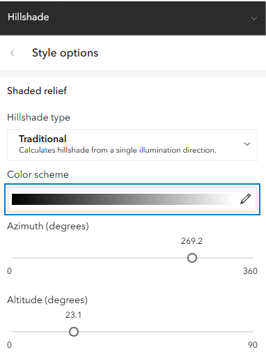

As you can guess, this part is still a work in progress. Check
back winter quarter, 2027 to see our progress

We are still discussing what tool to emphasize. Will we leave ArcGIS Online
behind for part 3 of the series?

Will we move to the Free and Open Source QGIS?

Stay tuned to find out!

## AGO layers vs. local layers

Keeping track of where the data underlying layers is located is challenging even for advanced geospatial analysts. 

– Will this session turn out to be very much a ‘where are my files’ reinforcement like we try to make the Unix Shell?

## Flavors of data analysis: 

- buffering
- interpolation
- zonal statistics
- raster calculation

### Raster calculations

Example analysis: from workshop 2, how did that slope layer get made?
With a raster calculation.

### Buffering
Example analysis: maybe your friend is really afraid of heights, and wants to make sure that the route doesn't include super steep drop offs. 

1. buffer 30 meters around the streets
1. There's a chance to teach about credits here. The buffer costs 2.x credits.
1. gotcha: layers much have unique names across the organization.
So use your initials in this step. `sb_jj_roads_buffer`
1. Find clusters of large values in the pixels that lay underneath the buffer.
1. highlight any intersection with areas where there are large numbers of very steep pixels nearby.
1. Cutting a raster to a mask is called `nibbling`

### another
Which parts of campus are least served by the bike path network?

Potential simple analysis as end product  (this section should be moved to 3) 
- Zonal statistics 
- Count number of points within a polygon 
- Heatmap from points 
- Buffering

## On the fly

### Improving symbology

#### Creating Shaded Relief (Hillshade) on the Fly

One use for a DEM is to make a shaded relief layer. That is a classic
view that gives the terrain realistic three-dimensional depth and
surface texture, we can generate a shaded relief visualization
dynamically:

1.  Duplicate the `ucsb_local_dem` layer.
2.  Rename the two DEM layers for clarity: name the top layer
    `Elevation (Color)` and the bottom layer
    `Elevation (Shaded Relief)`.
3.  Change the symbology style to **Shaded Relief**.

Shaded relief simulates how sunlight illuminates terrain, casting
shadows based on the position of the sun measured as two angles: Azimuth
and Altitude

-   **Azimuth**: The compass direction from which the illumination
    source (the sun) originates, measured in degrees clockwise from
    north (0° = North, 90° = East, 180° = South, 270° = West). In
    cartography, the sun is traditionally positioned in the northwest
    (315°) or west (270°) to match how the human brain interprets light
    and shadow, preventing an optical illusion known as "relief
    inversion" where mountains appear as valleys. For our map, we
    position the light source from the west.
-   **Altitude**: The angle of the sun above the horizon, measured from
    0° (level with the horizon at sunrise/sunset) to 90° (directly
    overhead at solar noon). A lower altitude (e.g., 30°–45°, typical of
    low winter sun) produces longer, more dramatic shadows that
    accentuate ridge lines, canyons, and valleys.

We can adjust those angles to show the sun in the morning or evening
here in Santa Barbara.

Adjust the transparency of the top colored elevation layer so the shaded
relief beneath shows through, creating an illuminated 3D terrain effect
under our roads.

{fig-alt="A rainbow colored hillshaded map with roads showing the software interface"}

This matches interim map 3 in our group.

This is a bit of an artificial example, because Esri offers a wide
variety of hillshade basemaps in the Living Atlas. Also: that was a
rather lengthy aside.

Now would be an excellent point to save your map.

